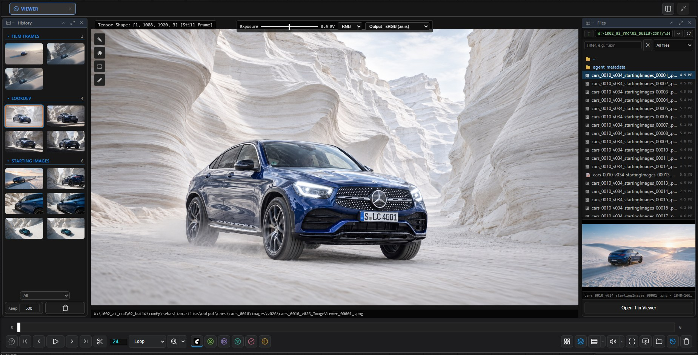

# ComfyUI Image Viewer

A viewer panel for [ComfyUI](https://github.com/comfyanonymous/ComfyUI). It displays what a workflow produces and adds the tools to work with the results in place: comparison, an OTIO timeline, a layer-based paint editor, a node compositor and a 3D previz scene.



## Spaces

| Space | Used for |
|---|---|
| [Viewer](docs/pages/viewer.md) | Stills, sequences, video and audio: zoom, wipe and contact-sheet compare, exposure, OCIO input, roto / SAM3 / annotation |
| [Edit](docs/pages/edit.md) | Multi-track editing on OpenTimelineIO with sound, titles and effects; film export and FCPXML / EDL interchange |
| [Paint](docs/pages/paint.md) | Layered image editing with masks, adjustment layers and generative fills; reads and writes `.ora` and `.psd` |
| [3D](docs/pages/3d.md) | GLB, FBX, USD, Alembic and Gaussian splats; previz shots, rigs and animation rendered back into the workflow |
| [Motion](docs/pages/motion.md) | Motion graphics scenes written by an agent |
| [Comp](docs/pages/comp.md) | Node-based compositing in linear float; renders stills, sequences or films |

## Panels

[History](docs/pages/history.md) (every render, in groups), [file browser](docs/pages/workspace.md#file-browser), [Parameters](docs/pages/workspace.md#parameters), [Agent code](docs/pages/agent-code.md) and [Dataset](docs/pages/dataset.md) dock to any rail. The viewer itself floats over the canvas, docks next to it or runs in its own browser window.

Also: [Dependencies](docs/pages/dependencies.md) (file provenance graph) and the [agentY](docs/pages/agentY.md) integration.

**Full documentation: [docs/index.md](docs/index.md).**

## Installation

### ComfyUI Manager (recommended)

1. Open the **ComfyUI Manager**, search for **ComfyUI-ImageViewer** and click **Install**.
2. Restart ComfyUI.

### Manual

```bash
cd ComfyUI/custom_nodes
git clone https://github.com/szprivate/ComfyUI-ImageViewer.git
pip install -r ComfyUI-ImageViewer/requirements.txt
```

Restart ComfyUI. Run `pip` with ComfyUI's own Python environment.

Writing videos and previz renders requires `imageio-ffmpeg` (installed by VideoHelperSuite, or `pip install imageio-ffmpeg`).

### First steps

Click **Image Viewer** in ComfyUI's top bar, add a **Send To Image Viewer** node to your workflow and queue it. Hover the panel and press <kbd>?</kbd> to list the hotkeys.

## Trademarks and independence

ComfyUI Image Viewer is an independent project. It is not affiliated with, endorsed by, sponsored by or otherwise connected to Adobe Inc. or any other software maker named in this repository.

Adobe and Photoshop are trademarks or registered trademarks of Adobe Inc. in the United States and/or other countries. DaVinci Resolve, Krita, GIMP and other names are trademarks of their owners. They are named here only to say which file formats and workflows the viewer works with, or to describe a feature by the behaviour people know from them. Naming them does not claim any connection to their owners.

Paint is a clean-room implementation. It contains no source code, binaries, brushes, presets, icons or other assets from Adobe products, and no code taken from other image editors. Its tools are written from how they behave and from publicly available sources, such as published research papers (for example "Poisson Image Editing", Pérez et al., 2003) and Adobe's publicly published Photoshop file-format specification for reading and writing `.psd` files. Reading `.abr` brush files only reads the brush shapes stored in files you provide yourself. No Adobe brushes ship with this project.

Paint's Generate workflows (`src/paint_workflows/`) are copies of workflows from ComfyUI's official workflow templates (Comfy-Org/workflow_templates), trimmed and with their inputs named for Paint. They name model files and where to download them; no model weights are part of this repository.

If you own rights in something in this repository and think it should not be here, please open an issue and it will be looked at promptly.

## License, contributing

Copyright © 2026 bEpic GmbH / Sebastian Zilius

**Free for personal and non-commercial use.**

- ✅ Personal projects, research, education, and non-commercial creative work
- ✅ Feel free to create your own fork and make updates - this is OpenSource, happy to include your Pull Requests if they're good!

- ❌ Commercial use of any kind is **prohibited** without explicit written permission from the author

Redistribution, modification, and use in source and binary forms are permitted **for non-commercial purposes only**, provided that this copyright notice is retained in all copies or substantial portions of the software.

For commercial licensing enquiries, contact the repository owner.

THIS SOFTWARE IS PROVIDED "AS IS", WITHOUT WARRANTY OF ANY KIND, EXPRESS OR IMPLIED.
