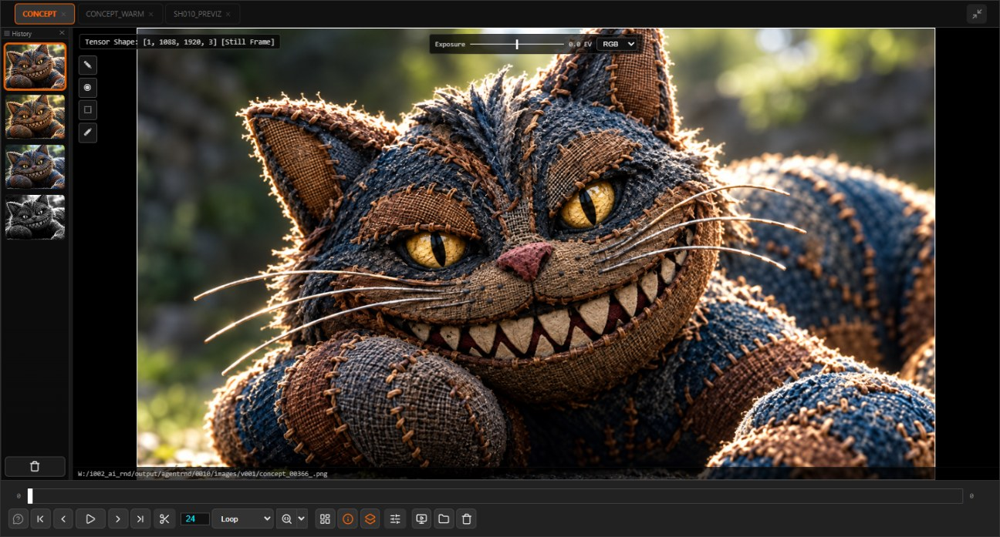
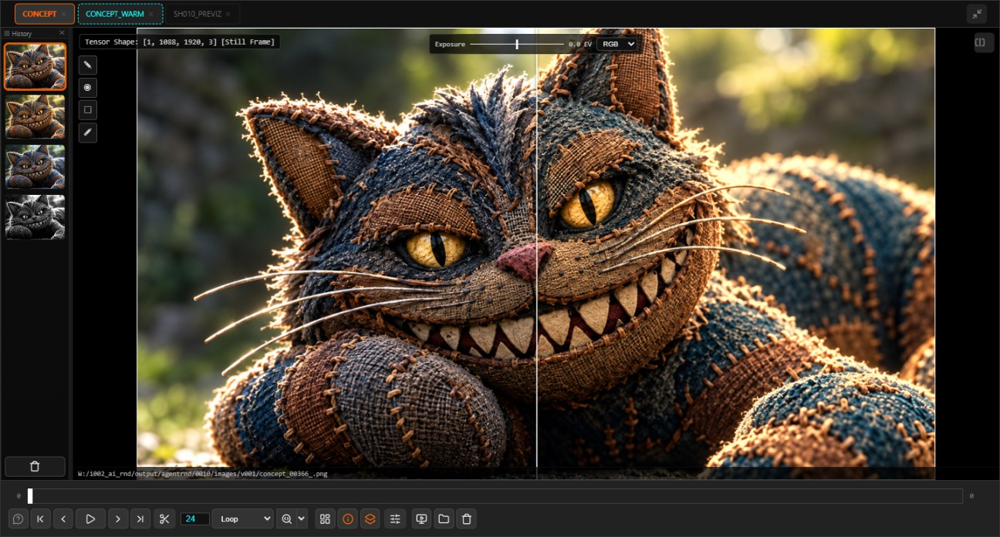
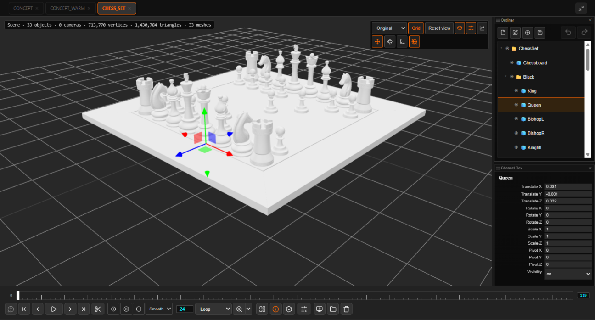

# ComfyUI Image Viewer

A viewer panel for [ComfyUI](https://github.com/comfyanonymous/ComfyUI): look at what your workflow makes, compare it, cut it, paint on it, and stage 3D shots, without leaving the graph.



## Spaces

| Space | What it is for |
|---|---|
| [Viewer](docs/viewer.md) | Pictures, videos and sounds: zoom, full screen, compare, play, exposure and channels |
| [History](docs/history.md) | Every render, kept in groups you fold, rename and drag between |
| [Dependencies](docs/dependencies.md) | What a file was made from and what was made from it, with its prompts (with agentY) |
| [Editor](docs/editor.md) | Cut films on a timeline, with sound, titles and effects |
| [Paint](docs/paint.md) | Edit a picture in layers, with AI fills through agentY |
| [3D & Previz](docs/3d.md) | View models, build and animate a shot, render it back into the workflow |
| [Motion](docs/motion.md) | Edit motion graphics an agent wrote |
| [Dataset](docs/dataset.md) | Review a LoRA training dataset and watch the training |
| [Agent code](docs/agent-code.md) | Read the code an agent writes |

Also: [Panels & workspace](docs/workspace.md) · [Working with agentY](docs/agentY.md) · [Nodes](docs/nodes.md) · [Hotkeys](docs/hotkeys.md) · [Reference](docs/reference.md)

<p>


</p>

---

## Installation

### Method 1 — ComfyUI Manager (recommended)
1. Open the **ComfyUI Manager** panel inside ComfyUI.
2. Search for **ComfyUI-ImageViewer** and click **Install**.
3. Restart ComfyUI.

### Method 2 — Manual installation
1. Navigate to your ComfyUI custom nodes folder:
   ```
   ComfyUI/custom_nodes/
   ```
2. Clone or copy this repository into that folder:
   ```bash
   git clone https://github.com/szprivate/ComfyUI-ImageViewer.git
   ```
3. Install Python dependencies (Pillow, numpy, and `usd-core` for the USD support):
   ```bash
   pip install -r ComfyUI-ImageViewer/requirements.txt
   ```
4. Restart ComfyUI.

Video encoding (MP4 / MOV / WebM saving and previz renders) needs `imageio-ffmpeg` — VideoHelperSuite installs it; otherwise `pip install imageio-ffmpeg`.

---

## Usage

1. Click **Image Viewer** in ComfyUI's top bar to show or hide the panel.
2. Add a **Send To Image Viewer** node and wire an image, mask, video or 3D model into it.
3. Run the workflow. The result shows up in the Viewer.
4. Hover the panel and press <kbd>?</kbd> for the keys.

---

## License, contributing

Copyright © 2026 bEpic GmbH / Sebastian Zilius

**Free for personal and non-commercial use.**

- ✅ Personal projects, research, education, and non-commercial creative work
- ✅ Feel free to create your own fork and make updates - this is OpenSource, happy to include your Pull Requests if they're good!

- ❌ Commercial use of any kind is **prohibited** without explicit written permission from the author

Redistribution, modification, and use in source and binary forms are permitted **for non-commercial purposes only**, provided that this copyright notice is retained in all copies or substantial portions of the software.

For commercial licensing enquiries, contact the repository owner.

THIS SOFTWARE IS PROVIDED "AS IS", WITHOUT WARRANTY OF ANY KIND, EXPRESS OR IMPLIED.
