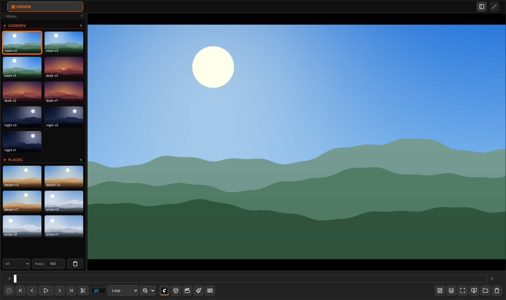

# ComfyUI Image Viewer

A viewer panel for [ComfyUI](https://github.com/comfyanonymous/ComfyUI): look at what your workflow makes, compare it, cut it, paint on it and stage 3D shots, without leaving the graph.



## Features

- **Viewer**: pictures, image sequences, videos and sounds. Zoom, full screen, exposure, single channels, OpenColorIO input colourspaces.
- **Compare**: wipe two renders, or lay up to 16 side by side on a contact sheet. Videos play in step.
- **History**: every render from every tab, kept in groups you can fold, rename and drag between.
- **Editor**: cut films on a timeline (OpenTimelineIO), with sound, titles, effects and keyframes. Export the film, or hand it to DaVinci Resolve.
- **Paint**: a picture in layers, with brushes, selections, masks, adjustment layers and text. Saves `.ora` and `.psd`.
- **3D & Previz**: open GLB, FBX, OBJ, USD, Alembic and Gaussian splats, build and animate a shot, render it back into the workflow.
- **Motion**: edit motion graphics scenes an agent wrote.
- **Comp**: layer pictures, films and sequences in a node graph (Merge, Transform, Grade, Blur, keyed), in linear float. Renders PNG / EXR frames or a film into the History and onto the canvas; the graph can also sit in ComfyUI's bottom panel.
- **Drawing tools**: roto mattes, SAM3 prompts and annotations, straight onto the picture.
- **Panels**: a file browser, the selected node's Parameters, Agent code and Dataset, docked where you like. The viewer docks beside the canvas or opens in its own window.
- **Dependencies**: what a file was made from and what was made from it, from the workflows saved with the files.
- **agentY**: tags, approvals and AI edits when [agentY](https://github.com/szprivate/agentY) is running.

How it all works: **[the docs](docs/index.md)**.

## Installation

### ComfyUI Manager (recommended)

1. Open the **ComfyUI Manager**, search for **ComfyUI-ImageViewer** and click **Install**.
2. Restart ComfyUI.

### Manual

```bash
cd ComfyUI/custom_nodes
git clone https://github.com/szprivate/ComfyUI-ImageViewer.git
pip install -r ComfyUI-ImageViewer/requirements.txt
```

Restart ComfyUI. Use ComfyUI's own Python for the `pip install`.

Saving videos and previz renders needs `imageio-ffmpeg` (VideoHelperSuite installs it, or `pip install imageio-ffmpeg`).

### First steps

Click **Image Viewer** in ComfyUI's top bar, wire a **Send To Image Viewer** node into your workflow and run it. Hover the panel and press <kbd>?</kbd> for the keys.

## Trademarks and independence

ComfyUI Image Viewer is an independent project. It is not affiliated with, endorsed by, sponsored by or otherwise connected to Adobe Inc. or any other software maker named in this repository.

Adobe and Photoshop are trademarks or registered trademarks of Adobe Inc. in the United States and/or other countries. DaVinci Resolve, Krita, GIMP and other names are trademarks of their owners. They are named here only to say which file formats and workflows the viewer works with, or to describe a feature by the behaviour people know from them. Naming them does not claim any connection to their owners.

Paint is a clean-room implementation. It contains no source code, binaries, brushes, presets, icons or other assets from Adobe products, and no code taken from other image editors. Its tools are written from how they behave and from publicly available sources, such as published research papers (for example "Poisson Image Editing", Pérez et al., 2003) and Adobe's publicly published Photoshop file-format specification for reading and writing `.psd` files. Reading `.abr` brush files only reads the brush shapes stored in files you provide yourself. No Adobe brushes ship with this project.

Paint's Generate workflows (`src/paint_workflows/`) are copies of workflows from ComfyUI's official workflow templates (Comfy-Org/workflow_templates), trimmed and with their inputs named for Paint. They name model files and where to download them; no model weights are part of this repository.

If you own rights in something in this repository and think it should not be here, please open an issue and it will be looked at promptly.

## License, contributing

Copyright © 2026 bEpic GmbH / Sebastian Zilius

**Free for personal and non-commercial use.**

- ✅ Personal projects, research, education, and non-commercial creative work
- ✅ Feel free to create your own fork and make updates - this is OpenSource, happy to include your Pull Requests if they're good!

- ❌ Commercial use of any kind is **prohibited** without explicit written permission from the author

Redistribution, modification, and use in source and binary forms are permitted **for non-commercial purposes only**, provided that this copyright notice is retained in all copies or substantial portions of the software.

For commercial licensing enquiries, contact the repository owner.

THIS SOFTWARE IS PROVIDED "AS IS", WITHOUT WARRANTY OF ANY KIND, EXPRESS OR IMPLIED.
