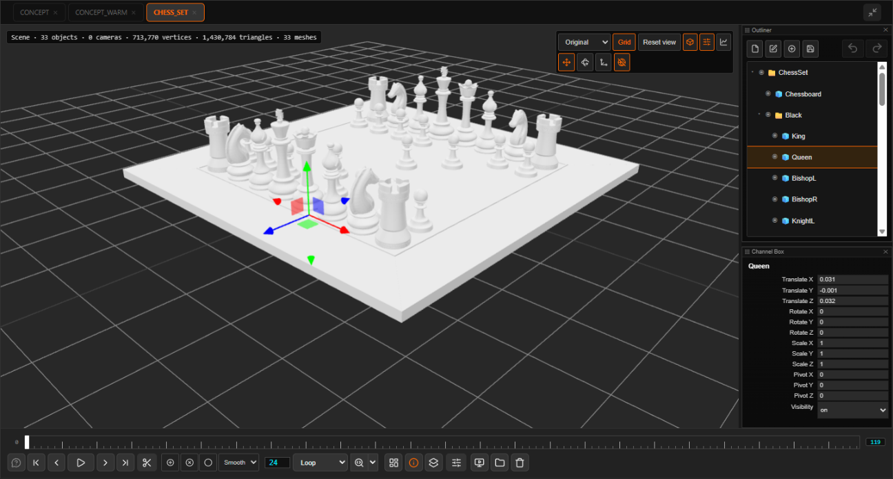
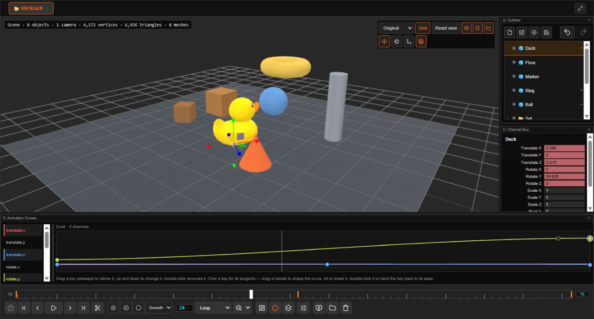
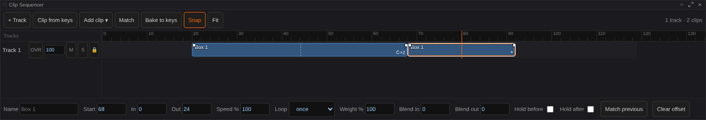
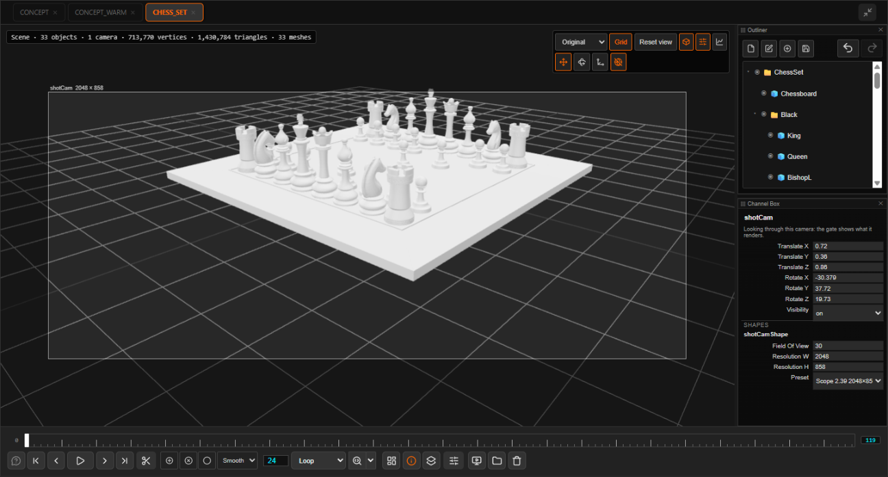
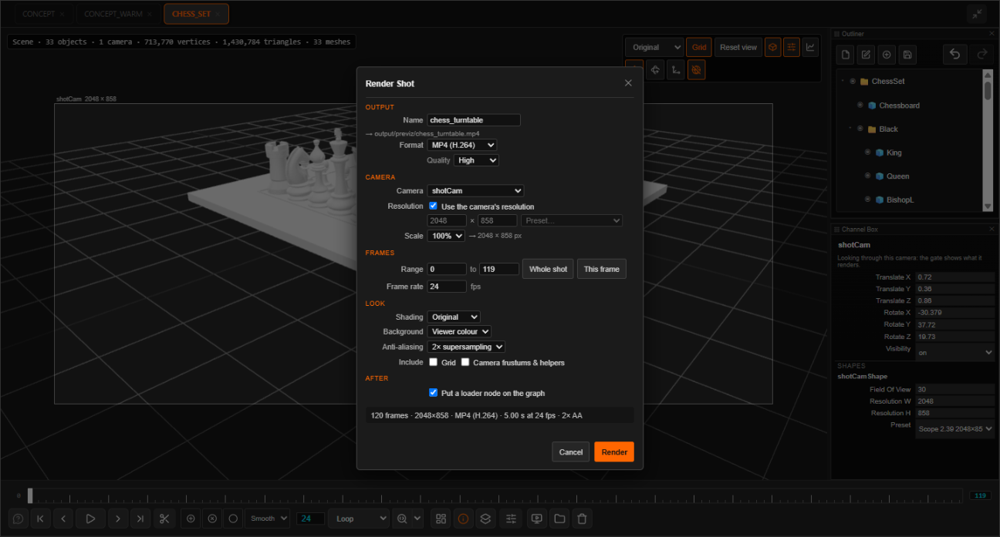

# 3D & Previz

[Home](index.md)

Every 3D tab is a scene. Open one model and you can add cameras, shapes and more models, animate them, and render the shot back into the workflow.

*The [Open Chess Set](https://github.com/usd-wg/assets/tree/main/full_assets/OpenChessSet), [CC BY 4.0](https://creativecommons.org/licenses/by/4.0/), Academy Software Foundation.*

## Opening

- **Formats**: GLB, glTF, FBX, OBJ, STL, PLY, USD (`.usd`, `.usda`, `.usdc`, `.usdz`), Alembic (`.abc`, read frame by frame, so a deforming cache plays) and Gaussian splats (`.spz`, `.splat`, `.ksplat`, `.sog`, splat `.ply`).
- Wire a `MESH` or 3D file into **Send To Image Viewer**, right-click a Load 3D node ▸ **Send to Image Viewer**, open a model from the file browser, or drop one in.
- **Open 3D…** in the lower bar's 3D menu: the open scene, else an empty one.
- An **Image Viewer 3D Scene (Previz)** node: press **Open in Image Viewer** on it.

## Moving around

| To | Do |
|---|---|
| Tumble / track / dolly | <kbd>Alt</kbd> + left / middle / right drag. Tumbling turns about what is under the pointer |
| Frame the scene | <kbd>F</kbd> |
| Select / move / rotate / scale | <kbd>Q</kbd> / <kbd>W</kbd> / <kbd>E</kbd> / <kbd>R</kbd> |
| World or local axes | <kbd>X</kbd> |
| Move the pivot | <kbd>Insert</kbd> |
| Look through a camera | **▣** on its row in the Outliner |
| Shading | Original, Clay, Normals or Wireframe in the 3D toolbar |

## Building a shot

Two panels, as in Maya: the **Outliner** (the scene's tree) and the **Channel Box** (the selected item's numbers). The 3D toolbar's icons show and hide them and the **Curve Editor**.

- **+** adds a model, a camera, an image plane (a plate or reference picture), a group, or a box, sphere, plane, cylinder, cone or torus.
- Drag rows in the Outliner to reorder and parent. Items keep their place in the world.
- In the Channel Box, type a value (`+=2` works) or drag a channel's name. With several items selected, all of them change.
- **Edit** has **Centre Pivot** and **Freeze Transformations**.
- Cameras have a **resolution**; looking through one shows its gate.
- <kbd>Ctrl</kbd>+<kbd>Z</kbd> undoes any edit. <kbd>Ctrl</kbd>+<kbd>D</kbd> duplicates, <kbd>Ctrl</kbd>+<kbd>G</kbd> groups.

## Animating

- **⊕** in the transport keys the selection at the playhead, **○** turns on autokey, **⊗** removes a key. Keys show as orange ticks on the timeline.
- <kbd>Shift</kbd>+<kbd>W</kbd> / <kbd>E</kbd> / <kbd>R</kbd> key translate / rotate / scale.
- Ease is **Smooth**, **Linear** or **Hold**. The **Curve Editor** shapes each channel with tangents (<kbd>Alt</kbd>+drag breaks them).
- The fps box and the last frame number on the timeline are the shot's rate and length.

## Constraints

Make one item follow others. Select the target(s) first, then the item that should follow them, and pick a kind from **Constrain** (beside **Rig** in the Outliner):

| Kind | What the follower does |
|---|---|
| Parent | moves and turns as if it hung under the targets |
| Point | takes the targets' position |
| Orient | takes the targets' rotation |
| Aim | stays put and turns to look at the targets (a camera along its -Z, anything else +Z; up is +Y) |
| Scale | takes the targets' scale |

- **Maintain offset** (on by default) keeps the follower where it is when the constraint is made; off, it snaps onto the targets.
- With several targets the weights decide the blend. Every weight, and each constraint's own **Weight**, is a channel in the Channel Box's **CONSTRAINTS** section: type a value, key it, shape it in the Curve Editor. Keying the weights switches an object from one target to another over time (a cup from the table to a hand).
- The section also has an on/off switch per constraint, **Skip** axes, the aim's axes and up (scene, a vector, towards an object, or an object's rotation), and buttons to select the targets, take the offset again from where the item is now, or remove it. Channels a constraint drives are tinted blue.
- Constraints stack in their order, so a Point then an Aim keeps the item on one object while it looks at another. A loop (an item following its own follower or child) is refused.
- **Constrain ▸ Bake constraints** keys the driven channels on every frame of the shot and takes the constraints off. **Export USD** bakes them into the stage by itself; renders and FBX / Alembic exports show them as they play.
### Animation layers

The **Anim Layers** panel (3D menu › Anim Layers) holds layers of animation on top of the keys you already have, as in Maya or MotionBuilder. The item's own keys are **BaseAnimation**, at the bottom.

- **+ Add** makes an *additive* layer: its keys are offsets added on top of what is below (scale multiplies). **+ Over** makes an *override* layer: its keys replace what is below, on the channels it keys only.
- Click a layer to make it **active**: from then on every key you set (gizmo, Channel Box, the key bar, the Rig menu) goes on that layer, and the Curve Editor shows that layer's curves. A move is keyed so the result on screen is exactly where you put it, whatever lies above or below. Click BaseAnimation to key the base again.
- Each layer has a **weight** (0 to 1; the diamond keys it, so a layer can fade in and out), **M** mute, **S** solo (only soloed layers and the base play) and **L** lock (takes no keys). **A / O** switches additive and override.
- **Merge** bakes the active layer into the one beneath it (the picture does not change); **Extract** moves the selected items' keys on the active layer to a new layer; ▲ ▼ reorder; ✕ deletes. Right-click a layer for the same, and to select the items keyed on it.
- **AI motion** (Rig menu) puts each take on an override layer of its own by default ("On a new animation layer" in the dialog), weighted over the frames it covers only, so the keys under it stay: compare takes with solo, blend them with the weight, or merge the one you keep.

Layers are saved with the scene and undo like any other edit. Renders and FBX / Alembic exports bake what you see.

## Clip Sequencer

**3D ▸ Clip Sequencer** (under the picture) puts animation into **clips on tracks**, so a walk, a wave and an AI take can be moved, repeated, retimed and blended like shots in an edit.

- **Clip from keys** moves the selection's keys into a clip (with a rigged character selected: all its controls). The clip plays exactly what the keys did; the keys now live in the clip.
- **Add clip ▾** places a source again at the playhead, or turns a model's own file animations into sources (a rigged character's are put on its controls, so they blend with keyed and AI clips).
- **AI motion**: tick *Land as a clip in the Clip Sequencer* in *Motion from text*. Each take lands on an **AI takes** track (a second take stacks above it), so takes can be compared with mute / solo.
- Drag a clip to move it (also onto another track; <kbd>Shift</kbd> switches snapping off). Drag an edge to trim, <kbd>Alt</kbd>+edge to retime (the speed changes), <kbd>Ctrl</kbd>+right edge to loop. The small squares at the top corners are the blend in / out. Two clips that overlap on one track cross-fade.
- A higher track lies over a lower one. **OVR** tracks replace what is below them by their weight, **ADD** tracks add their change on top. **M** mutes, **S** solos, the lock keeps a track's clips as they are.
- **Match** lines a clip up with the clip before it on the same character: it starts where that one left the character, facing the same way. A cycling clip with **Walk on** walks forward each turn instead of running on the spot.
- **Plays on** (in the clip's numbers) plays a clip on another rigged character; controls are matched by their role.
- **Bake to keys** turns everything the clips play back into keys and removes the clips. Undo brings them back.
- Keys while the panel has the focus: <kbd>Del</kbd> remove, <kbd>Ctrl</kbd>+<kbd>D</kbd> duplicate, <kbd>S</kbd> split at the playhead, <kbd>M</kbd> match, <kbd>Ctrl</kbd>+<kbd>B</kbd> bake, <kbd>F</kbd> fit, <kbd>[</kbd> / <kbd>]</kbd> zoom.
- Renders and the FBX / Alembic export play the clips; the USD export writes them as baked keys.

## Posing and rigging extras

All in the **Rig** menu once a character has controls.

- **Pose library…** keeps poses for every scene on this machine. Name a pose and **Save** it; double-click a pose (or pick it and **Apply**) to put it on. **Blend** puts it on part way, **Mirrored** puts it on the other side, **Selected controls only** saves or applies just the controls you picked. A pose goes onto the same rig, another rig of the same skeleton, or (by the limbs) another humanoid.
- **Flip pose** mirrors the whole body left to right. **Copy pose** / **Paste pose** carry a pose to another frame or character.
- **Space…** makes a control follow something else: the world, the root, the COG, the chest, the head, a hand. The switch happens at the playhead without the control jumping; when the control is animated the frames before keep the old space.
- **Match FK to IK** / **Match IK to FK** line one side of a limb up with the other without switching it.
- **Set Driven Key…**: load a driver (select it, *Load selected*, pick its channel), load the driven items and pick their channels (Ctrl-click for several). Key once at rest, move the driver, pose the driven channels, Key again. What the curve gives is added to the channel, so you can still animate it.
- **Add attribute…** puts a keyable number on a control (a "fist" slider for a hand, say) - a good driver.
- **Blendshapes**: a model's morph targets are in the Channel Box under *BLENDSHAPES*, keyable like any channel. **Add facial controls** puts a board beside the head with joysticks for the brows, eyes, cheeks, mouth and jaw that drive the blendshapes they find by name (the ARKit set, in any spelling); the rest stay in the Channel Box.

## Rendering into the workflow

**Export ▸ Render…** opens the render dialog: camera, size, frame range, MP4 / MOV / WebM or PNG, shading, a transparent background (PNG), anti-aliasing. The render lands in `output/previz/<name>` and as a loader node on the graph. The 3D Scene node reads it back as `images`.

## Saving and USD

- A scene on a 3D Scene node is saved with the workflow. **Export ▸ Save scene…** writes it to `output/3d_scenes`.
- **Export ▸ Export USD…** writes the shot as a USD stage: groups as Xforms, models as payloads, animation baked per frame. **+ ▸ Import USD…** reads one back, from here or from anywhere else.

## Limits

- No lights of its own yet; scenes use the same rig as ComfyUI's Load 3D.
- OBJ shows without its `.mtl`. Draco and KTX2 glTF files don't load.
- USD shows through a flattened copy, so its materials and variants are not visible.
