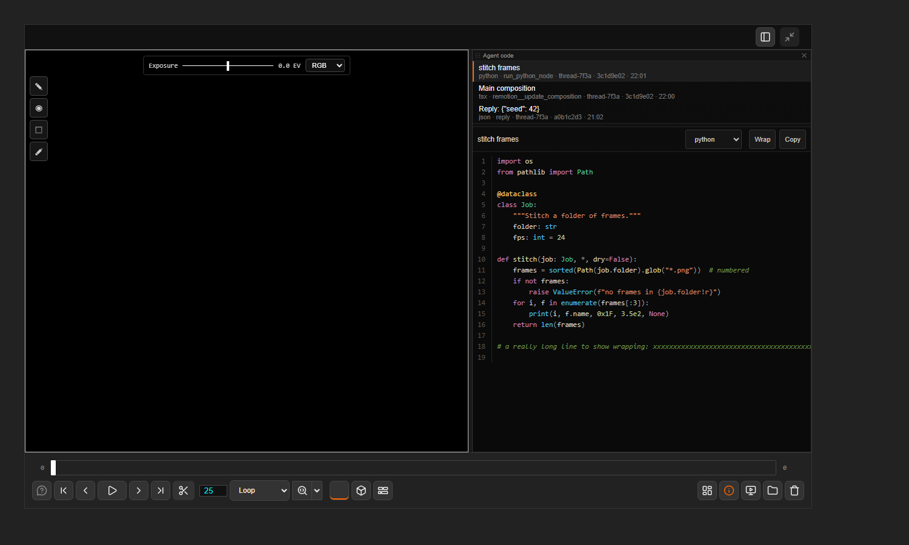

# Agent code

[Home](index.md)

A read-only tab for the code agentY writes: scripts it runs, files it writes, code in its replies. Highlighted, with line numbers, **Copy** and **Wrap**.

- **ComfyUI ▸ Agent code** in the lower bar opens the live feed: a list of snippets, newest first, and the one shown. A dot on the ComfyUI button says new code arrived.
- Double-click a text or code file in the file browser to open it in a tab of its own. Several can be open at once.
