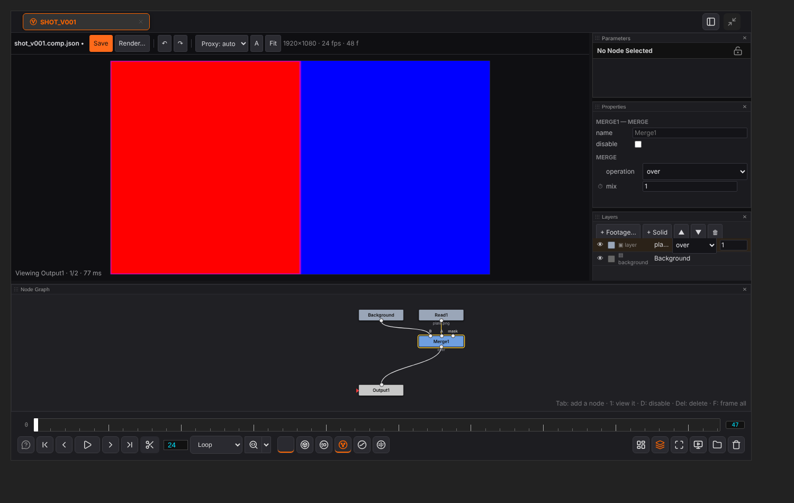

# Comp

[Home](index.md)

Comp layers pictures, films and image sequences in a node graph, the way Nuke does: Merge, Transform, Grade and Blur, keyed over time, in linear float. A comp is a file (`*.comp.json`). It has nothing to do with ComfyUI's workflow: its nodes live in the comp, never on the canvas, and Run does not touch them.

## Opening

- **Open Comp…** in the lower bar's Comp menu: the open comp, else the last one, else a tab that offers **New comp** and **Open…**.
- **New comp** in the same menu: a new file in your shot's `comps` folder when the canvas names a sequence and shot, else in `output/imageviewer/comps/`. It starts as a black background going into an Output.
- Double-click a `*.comp.json` in the file browser, or let agentY show it.

## The node graph

The **Node Graph** panel is up when a comp opens. The picture runs from top to bottom: a node's inputs are on its top edge, its output at the bottom.

- **Tab** opens a list of nodes to add; type to narrow it. With a node selected, the new one goes in under it.
- Drag a node to move it. Drag on empty space to select several, or Alt-drag or middle-drag to pan. The wheel zooms.
- Drag from an output to an input to connect them. Drag a connected input away to take the wire off.
- **1**, or the eye at a node's right edge, shows that node in the picture: it gets a red outline and a VIEWER tag, and the eye again (or viewing the Output) goes back to the comp. **D** switches a node off, **Del** deletes it (what read it reads its first input instead), **F** frames the whole graph.
- Drop History thumbnails or file browser rows on the graph to make Read nodes. A frame of a numbered sequence brings the whole sequence (`shot.####.exr`).

| Node | What it does |
|---|---|
| Read | A picture, a film or a numbered sequence. *Offset* slides it in time; *Colourspace* auto treats EXR and HDR as linear, everything else as sRGB; *Fit* lays a picture of another size into the comp |
| Constant | A colour over the whole frame |
| Roto | Shapes drawn on the picture. Without an input it is a white matte, with one it cuts its input out. Each shape adds or subtracts, has a feather and can be animated |
| Merge | Lays A over B (or plus, multiply, screen, in, out, atop, mask, stencil, and the rest of Nuke's operations), with a mix and an optional mask input |
| Copy | B with some of its channels taken from A (for example A's alpha) |
| Transform | Moves, rotates and scales about a centre |
| Crop | Keeps a box of the picture, with a soft edge if you like |
| Grade | Black and white point, lift, gain, multiply, offset, gamma, saturation, mix |
| ColorCorrect | A colour corrector laid out like After Effects' Color Finesse. **HSL** (hue, saturation, brightness, contrast about a centre) and **RGB** (gain, gamma, pedestal, for all channels and for R, G, B) for Master, Highlights, Midtones and Shadows. **Hue offsets** has a colour wheel per range: drag to push that range towards a colour, double-click to reset. **Luma ranges** sets where shadows end and highlights start, with the curves drawn. **Secondaries** A and B each correct one colour (picked with ⌖), qualified by hue, saturation and luma. *View* shows a range or a secondary's matte as grey |
| Keyer | Chroma (a screen colour, picked from the picture with ⌖) or luma, with tolerance, softness and despill |
| LumaKeyer | A matte from brightness (luminance, the largest channel, or one channel): transparent below *low*, solid from *low* + *low soft*, and transparent again past *high*. *Clip black* / *clip white* firm it up; *output* matte shows it as grey |
| ChromaKeyer | A colour-difference key. Pick the screen with ⌖. *Screen gain* takes more as screen, *clip black* cleans the screen and *clip white* firms up the subject. *Despill* holds the screen's channel to the larger (or the mean) of the other two. *Output* gives the keyed picture, the matte, or despill only |
| Blur | A Gaussian blur, its size in pixels of the comp |
| MotionBlur | Blurs along the motion while the shutter is open. It takes motion vectors from a Vectors node in its second input, or works them out itself |
| DepthBlur | Blurs by the distance from the focus, read from a depth map in its second input (red, any channel, or luminance). *Filter* lens blurs through a disc, as Defocus does |
| Defocus | A lens out of focus: every pixel spread over the aperture, a disc or a polygon of 3 to 16 blades (*rotation*, *aspect* for an anamorphic lens). *Bloom* brightens what is above the *threshold* first, so highlights become bright bokeh |
| Erode/Dilate | Shrinks (size below 0) or grows (above 0) the picture's light parts, by a box or a disc; *channels* alpha works on the matte alone. Fractional sizes are smooth |
| Laplacian | *laplacian*: the edges, the picture less its neighbours, after a blur by *size* (a Laplacian of Gaussian). *highpass*: the picture less its blur. Then *gain* and *offset* (0.5 for the usual grey) |
| Shuffle | Each channel from any channel, or 0 or 1 |
| ChannelMerge | One channel of A with one of B (union, plus, minus, from, multiply, divide, in, out, stencil, max, min, absminus, xor) into B's alpha, a colour channel, rgb or rgba |
| ChannelMath | Arithmetic on the chosen channels: add, multiply, power, invert, clamp, min, max, abs, threshold, set |
| Premult / Unpremult | Multiply the colour by the alpha, or divide it back |
| Retime | Plays its input faster, slower or backwards (*speed*, *start*, *offset*), the nearest frame or two mixed |
| Vectors | Motion vectors measured from the footage (optical flow): red and green where each pixel goes in the next frame, blue and alpha where it came from. *Detail* half (the default) measures on a picture half the size, which is much faster |
| Output | What the comp renders |

Vectors, MotionBlur, DepthBlur and Defocus take seconds a frame at full size. The picture keeps their results while you work further down the graph.

### Drawing a Roto shape

Select the Roto node and press **Draw a shape** in its Properties, then click the points on the picture. Click the first point again, double-click or press Enter to close the shape; Backspace takes the last point back, Esc stops. Drag a point to move it. The stopwatch beside a shape animates it: moving a point then sets a key at the playhead, and the shape moves in straight lines between keys.

## Properties

The selected node's values at the playhead. They work as in Motion: the stopwatch animates a value, and changing an animated value sets a key there. With nothing selected the panel holds the comp's size, frame rate and length.

## Layers

The **Layers** panel (Comp menu ▸ Layers) shows the same graph as a stack of layers. Each Merge on the main pipe is a layer, its A branch is the layer's picture, and what is at the top of the pipe is the background. Reorder, switch off, change the operation or the mix, or add footage or a solid on top: each one is a change to the graph, so the two views always agree. A branch with a Merge of its own shows as a group.

## The picture and time

The picture fills the canvas. **Proxy** draws it smaller while you work (it is always rendered full size), **A** shows the alpha, **Fit** fits it in the window. The viewer's own transport plays the comp; its fps box and last-frame number edit the comp's rate and length.

## In ComfyUI's bottom panel

ComfyUI's bottom panel (the strip under the canvas with the Terminal and the Logs) has a **Comp** tab. It shows the node graph of the comp the viewer is on, with play, step, the frame and a button that brings the viewer up. It is the same graph, moved there while the tab is open, so you can work on the comp beside your workflow. Drag the panel's edge up to give it room. **Show it here** in the viewer's Node Graph panel takes it back.

## Rendering

**Render…** opens the export dialog: PNG, EXR (linear half float) or TIFF frames, or an MP4, MOV (ProRes or H.264) or WebM film; all frames, the in-out range, or just this frame. It saves the comp first and renders it on the server at full size, by the same arithmetic as the preview. The result lands where every export goes (versioned, in the shot's folder when there is one), joins the History, and is put on the ComfyUI canvas as a loader node, ready to wire into a workflow.

## Clean room

Every node is written here from published maths and from how compositing tools behave: Porter–Duff and the usual Merge and Grade formulas, Horn–Schunck optical flow, colour-difference keying, box and Gaussian filters. No code, shaders or assets come from Nuke, After Effects, Color Finesse, Keylight, any other program, or GPL sources.

