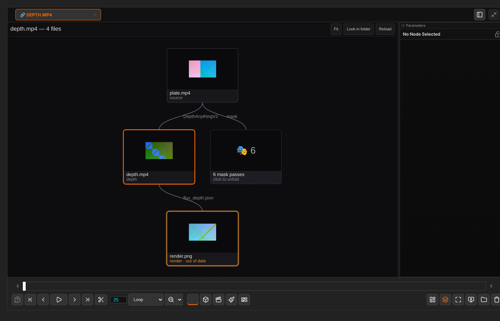
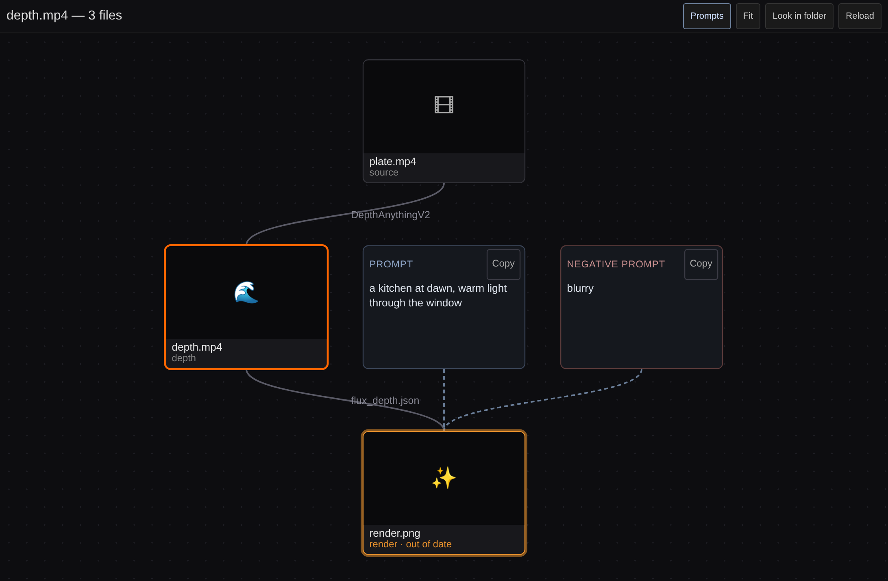

# Dependencies

[Home](index.md)

With [agentY](https://github.com/szprivate/agentY) running, every file it or a Send node saves records what it was made from. Right-click a History thumbnail ▸ **Show dependencies** to see that record as a graph, top to bottom: inputs above, what was made from them below.

- Each node is a file, with its thumbnail and kind (source, depth, mask, render…). Each edge names what made it.
- The file you started from is outlined. A file made from an older version of an input is marked **out of date** (hover for why). A missing file is greyed.
- **Prompts** sit in text boxes one row above the file they made, with a **Copy** button. The **Prompts** button hides them.
- More than four passes of one kind fold into one node. Click it to unfold.

| To | Do |
|---|---|
| Open a file | Click its node |
| Centre on a file | Double-click its node |
| Fit the graph | <kbd>F</kbd>, or **Fit** |
| Find older files made before the record existed | **Look in folder** |
| Read it again | **Reload** |

Without agentY running, the tab says so.
