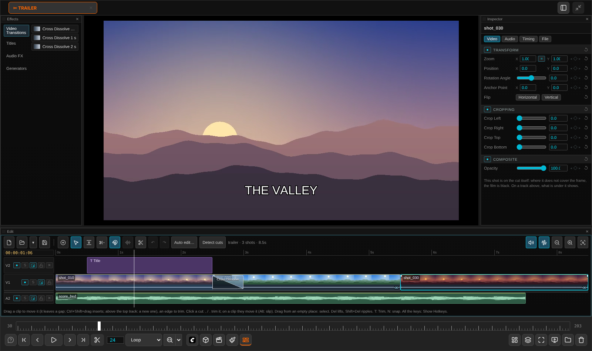

# Editor

[Home](index.md)

The Editor cuts films on a timeline, the way an NLE does. A cut is an OpenTimelineIO file (`.otio`); it plays in its own tab before anything is rendered.

## Opening a cut

- **Open Edit…** in the lower bar's Timeline menu: the open cut, else the last one, else an empty one.
- On a film with a `.otio` beside it (agentY writes one), the timeline button lights up. Click it.
- **Open cut…** (<kbd>Ctrl</kbd>+<kbd>O</kbd>, or the folder button on the Edit bar), or double-click a `.otio` in the file browser.

Three panels belong to a cut and show only on its tab: **Edit** (the timeline), **Inspector** (the selected clip's numbers) and **Effects** (transitions, titles, colours, sound effects).

## Tracks

| Track | Holds |
|---|---|
| **V1** | The cut: one shot after another, with dissolves and gaps |
| **V2 and up** | Clips placed at a time. They cover what is under them, picture and sound. Titles live here |
| **A1** | The music bed under the whole film |
| **Sound tracks** | Sound clips placed at a time |

The film runs until the last picture or the last sound ends, whichever is later. Past the last picture it is black.

## Adding clips

- Drag files from the file browser, thumbnails from the History, or nodes off the canvas onto the timeline.
- **Add ▸ Files…** or **Add ▸ Selected canvas nodes** inserts at the playhead: the shot there is split and what follows moves on.
- Drag above the top video track or below the bottom sound track for a new track.

## Cutting

| Mode | Key | An edge… | The body… |
|---|---|---|---|
| **Select** | <kbd>A</kbd> | trims that edge, leaving a gap | moves the clip over what is there |
| **Trim** | <kbd>T</kbd> | ripples (what follows moves) | upper half slips, lower half slides |
| **Blade** | <kbd>B</kbd> | | cuts the clip where you click |

The middle of a cut rolls it in both modes. Double-click a cut (either side of it, its middle, or a dissolve) to go into the Trim mode with that edit selected: <kbd>,</kbd> / <kbd>.</kbd> then ripple or roll it a frame. <kbd>N</kbd> turns snapping on and off. While trimming, the two frames either side of the cut are shown over the picture.

| To | Do |
|---|---|
| Cut at the playhead | <kbd>Ctrl</kbd>+<kbd>B</kbd> |
| Delete, leaving a gap / closing it | <kbd>Del</kbd> / <kbd>Shift</kbd>+<kbd>Del</kbd> |
| Switch a clip off | <kbd>D</kbd> |
| See the source of the frame under the playhead (match frame) | <kbd>F</kbd>, or right-click › Match frame |
| Go from the Source viewer's frame to where the cut shows it | <kbd>Shift</kbd>+<kbd>F</kbd> |
| Retime a clip | <kbd>Alt</kbd>+drag an edge |
| Loop a clip longer than its source | <kbd>Ctrl</kbd>+drag its out edge |
| Set in / out | <kbd>I</kbd> / <kbd>O</kbd>, or <kbd>X</kbd> around the clip |
| Copy a clip's look onto others | <kbd>Ctrl</kbd>+<kbd>C</kbd>, then <kbd>Alt</kbd>+<kbd>V</kbd> (Paste Attributes) |
| Undo / redo | <kbd>Ctrl</kbd>+<kbd>Z</kbd> / <kbd>Ctrl</kbd>+<kbd>Shift</kbd>+<kbd>Z</kbd> |

## The Source viewer

The Source viewer is a second viewer for one source clip, like Resolve's source monitor. Turn it on with the Source viewer button on the timeline's bar (or Timeline › Source viewer). It stands to the left of the picture.

It has two layouts, like Resolve's single and dual viewer modes. Switch between them in the menu (▾) after the edit buttons on the bar, or with the button at the top of the Source viewer:
- **Dual**: the source on the left, the timeline's picture on the right.
- **Single**: one viewer, showing the source or the timeline. <kbd>Q</kbd> switches between them.

Drop a clip from the History or the file browser onto it, or right-click a clip on the timeline › Open in Source viewer. While the Source viewer is open, <kbd>F</kbd> (match frame) loads the clip there instead of opening it in the Viewer tab.

Click the Source viewer to give it the keys. Then:
- <kbd>Space</kbd> plays the source.
- The arrow keys step through it.
- <kbd>I</kbd> and <kbd>O</kbd> mark its in and out.
- <kbd>Alt</kbd>+<kbd>X</kbd> clears both marks.

To bring the marked part into the cut, use the buttons on the timeline's bar (right of the Source viewer button: Insert, Overwrite and Replace, the rest in the ▾ menu beside them, as in Resolve), or these keys from the timeline or the Source viewer:

| Edit | Key | What it does |
|---|---|---|
| Insert | <kbd>F9</kbd> | puts it in at the playhead; what follows moves on |
| Overwrite | <kbd>F10</kbd> | lays it over what is there |
| Replace | <kbd>F11</kbd> | swaps the clip under the playhead for the source, at the clip's length, so that the two playheads show the same frame |
| Place on top | <kbd>F12</kbd> | puts it on the first video track above that is free there |
| Ripple overwrite | <kbd>Shift</kbd>+<kbd>F10</kbd> | swaps the shot under the playhead for the marked part; what follows moves by the difference |
| Fit to fill | <kbd>Shift</kbd>+<kbd>F11</kbd> | retimes the marked part to fill the timeline's in-out range |
| Append at end | <kbd>Shift</kbd>+<kbd>F12</kbd> | adds it after the last shot |

This is three-point editing. Of the source's in and out and the timeline's in and out, set any three and the fourth follows. With no timeline in, the playhead counts as one.

Which track the clip goes to is set in the track headers, as in Resolve. While the Source viewer is on, each header has a patch box at its left. The source's **V1** box sits on the video track its picture goes to (V1 to begin with), and its **A1** box on the sound track a sound file goes to. Click another track's box to move it there.

Some browsers keep <kbd>F11</kbd> for full screen. If yours does, use the buttons.

## Compound clips

Select several clips, right-click one and choose **New compound clip**. They become one clip that holds them: V1 shots that are next to each other, with whatever you selected on the other tracks during their time. Clips from tracks other than V1 work too; the compound clip then lies on the lowest of their tracks. A compound clip moves, trims, splits, switches off and takes a volume like any clip. Its edges trim against the film inside it. It has no speed, loop, reverse or freeze of its own, because the clips inside keep theirs. It shows a ⧉ badge with the number of clips inside. Right-click it and choose **Decompose in place** to put its clips back where they were.

The cut file stores the clips inside it as ordinary clips, so the render, **Export to Resolve…** and agentY see real clips. The panel puts the compound clip back together when the cut is opened again. You cannot open a compound clip in a timeline of its own yet.

## Markers

Press <kbd>M</kbd> to put a marker at the playhead. With a clip selected and the playhead inside it, the marker goes on the clip and moves with its picture; otherwise it goes on the timeline (the ruler). Press <kbd>M</kbd> on a marker, or double-click it, to give it a name, a colour, notes and a duration. Drag a marker to move it, click it and press <kbd>Del</kbd> to remove it, or right-click it for colours and "delete all of this colour". <kbd>Alt</kbd>+<kbd>M</kbd> removes the markers at the playhead; <kbd>Shift</kbd>+<kbd>↑</kbd> / <kbd>↓</kbd> jump from marker to marker. Markers are saved in the cut, are snap targets, and go to Resolve with **Export to Resolve…**.

## The in-out range, swapping, selecting forward

- **Lift / extract**: with an in and out set (<kbd>I</kbd> / <kbd>O</kbd>) and nothing selected, <kbd>Del</kbd> takes what lies between them off every track whose Auto Track Selector is on and leaves a gap; <kbd>Shift</kbd>+<kbd>Del</kbd> also closes the gap, so everything after the out moves up. Both are on the ruler's right-click menu too. The music bed (A1) is left as it is.
- **Swap clips**: <kbd>Ctrl</kbd>+<kbd>Shift</kbd>+<kbd>,</kbd> / <kbd>.</kbd> swaps the selected clip with the one before / after it on its track.
- **Select forward**: <kbd>Y</kbd> selects the clips from the playhead on, on the selected clip's track (else V1); <kbd>Alt</kbd>+<kbd>Y</kbd> on every track. <kbd>Shift</kbd>+<kbd>Y</kbd> / <kbd>Alt</kbd>+<kbd>Shift</kbd>+<kbd>Y</kbd> select the ones before it (in Resolve that is <kbd>Ctrl</kbd>+<kbd>Y</kbd>, which is Redo here).

**Transitions**: the Effects panel has Cross Dissolve, Dip to Black, Dip to White and Wipe. Drop one on a cut. Right-click a transition's bar to change its type, or select it to set its length, its dip colour or its wipe direction in the Inspector. The export renders them; Export to Resolve turns dips and wipes into cross dissolves.

**Freeze frame and reverse**: right-click a clip and pick Freeze frame (the frame under the playhead is held for the whole clip, or its first frame when the playhead is not on it) or Reverse clip (the same frames, last one first). Pick it again to take it off; the Inspector's Timing tab has the same choice under Motion. Both are silent. A reversed clip can still be retimed; a frozen one is just made longer or shorter. They are rendered in the export, saved in the .otio (as OTIO's own FreezeFrame and a negative LinearTimeWarp), and come to Resolve as a held or backward time map.

**Speed ramps**: in the Inspector's Timing tab, the diamond beside Speed % sets a speed keyframe at the playhead. Move the playhead, type another speed, and a second keyframe is made: the clip speeds up or slows down between them, eased as you pick by right-clicking a keyframe. The clip keeps its length, so what it shows changes. The keyframes are diamonds on the clip and can be dragged. A ramped clip plays silent, frame by frame, can't be retimed by its edges and doesn't loop. The export renders it; Export to Resolve writes it as a time map with a point every four frames.

**Dynamic trim** (<kbd>W</kbd>, or the ⟨…⟩ button on the bar): with it on, <kbd>J</kbd> / <kbd>L</kbd> move the selected cut backwards / forwards frame by frame, as if playing it, and <kbd>K</kbd> stops. Press <kbd>L</kbd> or <kbd>J</kbd> again for 2×, 4×, 8×. With a clip selected and no cut, the clip slips (Trim mode) or slides (Selection). A whole run is one undo step.

<kbd>J</kbd> <kbd>K</kbd> <kbd>L</kbd> play backwards, stop and play. Press <kbd>?</kbd> on a cut's tab for every key.

**Proxy playback** (the lightning button on the Edit bar, on by default): films bigger than 720p, or with key frames far apart, play and scrub from a lighter 540p copy, and compressed sounds (MP3 and the like) from a WAV copy, which stays in step with the picture. The server makes each once, in the background; until it is ready the file itself plays. Exports always use the files themselves.

## Sound

- **Sound on / off**: the speaker on the Edit bar (<kbd>Ctrl</kbd>+<kbd>Shift</kbd>+<kbd>M</kbd>). **Scrub sound**: the waveform button (<kbd>Shift</kbd>+<kbd>M</kbd>) plays the sound under the playhead as you drag. Neither changes the export.
- **Volume**: drag a sound clip's volume line. <kbd>Alt</kbd>+click adds a point.
- **Fades**: drag the small squares at a sound clip's top corners.
- **Crossfade**: <kbd>Shift</kbd>+<kbd>T</kbd> at a cut between two sound clips.
- **Sound effects**: drag one from Effects onto a sound clip.
- **A film's own sound**: <kbd>Ctrl</kbd>+<kbd>Alt</kbd>+<kbd>L</kbd> unlinks it onto a sound track, and links it back.
- **Mixer**: Timeline › Mixer opens the mixer in its own panel, under the picture to the right of the timeline. Drag its title bar to put it somewhere else. It has a strip for each sound track (A1, the bed, and the others) and a master. Each strip has a meter, a fader, a pan, M (switch the track off) and S (solo). The fader and pan are the track's own Gain and Pan effects, so the export and Export to Resolve hear them. If you keyframed them in the Inspector, moving them sets a keyframe at the playhead. V1 has a meter only, because each film plays at its own clip volume. A double-click puts a fader back to 0 dB, or a pan back to the centre.

## Look and titles

The **Inspector** has the selected clip's zoom, position, rotation, crop, opacity and volume. The ◇ next to a row keys it at the playhead, so anything there can be animated. With several clips selected, a change goes to all of them.

**Titles** come from Effects: drop one on the timeline and type the words in the Inspector's Title tab (font, size, colour, outline, shadow, box).

## Saving and exporting

| | |
|---|---|
| **Save cut** (<kbd>Ctrl</kbd>+<kbd>S</kbd>) | Writes the `.otio`. The bar says where it went |
| **Save cut as…** (<kbd>Ctrl</kbd>+<kbd>Shift</kbd>+<kbd>S</kbd>) | Another name or folder |
| **Export film…** | Renders the film, picture and sound. It never writes over the film the cut came from: it saves the next version |
| **Export to Resolve…** | A folder with the media, an FCPXML, an EDL and an OTIO, ready for DaVinci Resolve |

## With agentY

- **Auto edit…** (in the wand menu on the timeline's bar, with Split at the playhead, Detect cuts, Undo and Redo) cuts on the beat of a sound, to an even rhythm, to the rhythm of another film, or to each shot's best part. **Detect cuts** finds the cuts inside a film.
- **Ask agentY…** sends the saved cut and your note to agentY. Its answer opens as a cut you can take in.
- **Recreate with changes…** (a clip's right-click) asks agentY to make the selected shots again. The new versions come back as **takes** of the clip; switch between them from its right-click menu.
