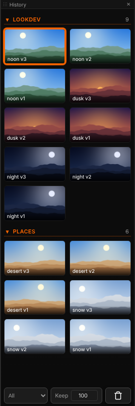

# History

[Home](index.md)

A panel (**ComfyUI ▸ History** in the lower bar). One History holds every render from every tab: 100 by default, up to 500 (the number at the foot of the panel). It survives a page reload. Clicking a thumbnail shows it in the tab it was made in.

## Groups

The strip is sorted into groups, each with a heading. A group is the `group` of the Send node that made it (or the stage agentY saved it from). The group used last comes first, newest first inside.

| To | Do |
|---|---|
| Fold a group | Click its heading |
| Move thumbnails to a group | Drag them onto its heading, or right-click ▸ **Move to group** |
| Rename a group | The ✎ on its heading, or right-click it. A name that exists merges the two |

## Moving through it

| To | Do |
|---|---|
| Newer / older | <kbd>↑</kbd> / <kbd>↓</kbd> |
| Select several | <kbd>Ctrl</kbd>+click, <kbd>Ctrl</kbd>+<kbd>Shift</kbd>+click for a range |
| Compare | <kbd>Shift</kbd>+click two, or select several and press <kbd>C</kbd>. See [Comparing](viewer.md#comparing) |
| Remove | <kbd>Shift</kbd>+<kbd>Delete</kbd>, or right-click ▸ **Remove**. The file on disk stays |
| Clear everything | The trash button in the lower bar |

## What a thumbnail can do

- **Drag it onto the graph** for a loader node holding it (a selection gives one node each). Drop it onto a loader to swap its file.
- **Drag it into a cut, a Paint canvas, a 3D scene** or the agentY chat.
- **Right-click** a thumbnail for, in this order: Copy image path, Remove from history, Move to group; then (for a film) **VFX**, **Show dependencies** (see [Dependencies](dependencies.md)), **Load workflow** (the workflow it was made with, in a new canvas tab, as in the Dependencies tab), Edit in Motion / **Edit in Paint**; then, with agentY, **Tag as asset…**, the colour tags, and **agentY: approve** while a run waits at a review step (see [Working with agentY](agentY.md)).

A thumbnail whose file is gone is dropped from the strip, after the server confirms it twice. The same render arriving twice is kept once.
