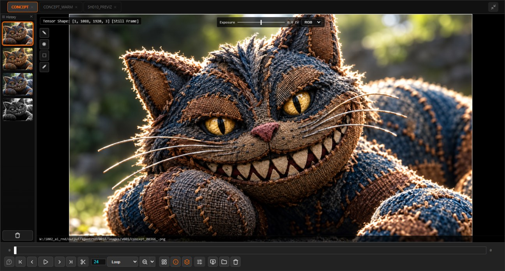

# ComfyUI Image Viewer

A viewer panel for ComfyUI: look at what your workflow makes, compare it, cut it, paint on it, and stage 3D shots, without leaving the graph.

## Getting started

1. Click **Image Viewer** in ComfyUI's top bar to show or hide the panel.
2. Add a **Send To Image Viewer** node and wire an image, mask, video or 3D model into it.
3. Run the workflow. The result shows up in the Viewer.
4. Hover the panel and press <kbd>?</kbd> for the keys.

## Spaces

The viewer has one space for looking at things and one for each kind of document. Open a space from its menu in the lower bar (**Open Edit…**, **Open Paint…**, **Open Motion…**, **Open 3D…**): you get the open one, else the last file you used there, else an empty one.

| Space | What it is for |
|---|---|
| [Viewer](viewer.md) | Look at pictures, videos and sounds: zoom, compare, play, exposure and channels |
| [History](history.md) | Every render, kept in groups |
| [Dependencies](dependencies.md) | What a file was made from, and what was made from it (with agentY) |
| [Editor](editor.md) | Cut films on a timeline, with sound, titles and effects |
| [Paint](paint.md) | Edit a picture in layers |
| [3D & Previz](3d.md) | View models, build and animate a shot, render it back into the workflow |
| [Motion](motion.md) | Edit motion graphics an agent wrote |
| [Dataset](dataset.md) | Review a LoRA training dataset and watch the training |
| [Agent code](agent-code.md) | Read the code an agent writes |

## Around the spaces

- [Panels & workspace](workspace.md): docking, layouts, the file browser, the Parameters panel, settings
- [Working with agentY](agentY.md): tags, approvals, annotations, the chat panel
- [Nodes](nodes.md): Send To Image Viewer, Roto, SAM3 Collector, 3D Scene
- [Hotkeys](hotkeys.md): the viewer's keys and how to change them
- [Reference](reference.md): HTTP routes, folders, temp files, environment variables
