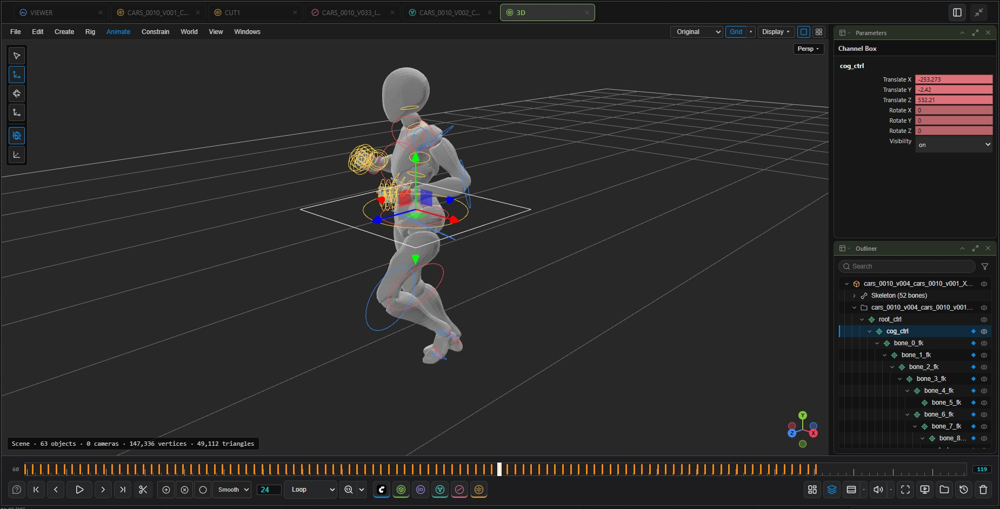

# 3D

[Home](../index.md)

Every 3D tab is a scene. Load a model, add cameras, lights and further models, animate them and render the shot back into the workflow.

## Opening

- Formats: GLB, glTF, FBX, OBJ, STL, PLY, USD (`.usd/.usda/.usdc/.usdz`), Alembic (evaluated per frame) and Gaussian splats (`.spz`, `.splat`, `.ksplat`, `.sog`, splat `.ply`).
- Connect a `MESH` or 3D file to **Send To Image Viewer**, open a model from the file browser or History, or use **Open 3D…** in the lower bar's 3D menu.
- On an **Image Viewer 3D Scene** node, press **Open in Image Viewer**.
- **File ▸ Import Model…** adds models to the scene. An FBX in centimetres comes in scaled to metres (scale 0.01 in the Channel Box; set it back to 1 to undo).

## Navigation

| Action | Input |
|---|---|
| Tumble / track / dolly | <kbd>Alt</kbd> + left / middle / right drag |
| Frame selection | <kbd>F</kbd> |
| Select / move / rotate / scale | <kbd>Q</kbd> / <kbd>W</kbd> / <kbd>E</kbd> / <kbd>R</kbd>; drag on empty space for a box selection |
| World / local axes | <kbd>X</kbd> |
| Show or hide object types (polygons, cameras, joints …) | **Display** menu, <kbd>Shift</kbd>+<kbd>1</kbd>..<kbd>9</kbd> |
| Multi-pane layouts | Layout buttons on the menu bar; <kbd>Space</kbd> over a pane maximises it |
| Shading | Original, Clay, Normals, Wireframe, **Path traced** |

The menu bar holds File, Edit, Create, Rig, Animate, Constrain, World, View and Windows; each entry shows its hotkey.

## Building a shot

- **Outliner**: the scene hierarchy, with search and type filter. Drag rows to reparent.
- **Channel Box**: shown in the Parameters panel on a 3D tab. Enter values (relative input such as `+=2` works) or drag a channel name. Several selected objects change together.
- **Create**: cameras, lights (point, spot, directional, area, dome), image planes, groups and primitives. New objects are placed at the world origin, standing on the grid. History thumbnails dropped into the view become models or image planes.
- Cameras have a resolution gate when looked through and an optional look-at target.
- <kbd>Ctrl</kbd>+<kbd>Z</kbd> undo, <kbd>Ctrl</kbd>+<kbd>D</kbd> duplicate, <kbd>Ctrl</kbd>+<kbd>G</kbd> group.

## Animation

- <kbd>S</kbd> keys the selection, <kbd>Shift</kbd>+<kbd>W</kbd> / <kbd>E</kbd> / <kbd>R</kbd> key translate / rotate / scale. The key bar in the transport has set key, delete key and autokey.
- **Curve Editor** and **Dope Sheet** (tabs under the viewport): move, scale and ease keys, buffer curves, simplify, pre / post infinity.
- **Anim Layers**: additive or override layers on top of the base animation, with weight, mute, solo, lock and merge.
- **Clip Sequencer**: animation as clips on tracks that can be moved, looped, retimed, matched and blended.
- **Constraints** (Constrain menu): parent, point, orient, scale and aim, with keyable weights. **Bake constraints** converts them to keys.
- **Playblast** renders the active view with a burnt-in HUD.

## Characters

- **Rig ▸ Add controls** builds FK / IK controls on a skinned model. **Auto-rig** (UniRig or SkinTokens) rigs a model that has no skeleton.
- **Animation** menu: IK / FK switch and match, space switching, pose library, flip / copy / paste pose, **Pose…** from a text description or a photo, motion from text (Kimodo), motion from video, lip sync from audio, set driven keys, custom attributes, blendshapes and facial controls.
- **File ▸ Export character**: FBX, USD or Alembic with baked motion. **Rig ▸ Add motion from file…** puts motion from FBX, USD or glTF onto a rigged character; a file exported from here restores the full rig.
  - Bones are matched by name, then by humanoid role. A character whose rest pose differs from the file's (an A-pose under a T-pose file) is lined up first, so the motion looks as it does in the file.
  - Pick several files, or a file with several animations, and each becomes a clip in the **Clip Sequencer**, placed one after another or kept as sources. The controls' own keys stay as they were.
- The **Character Picker** panel shows a character's controls as buttons.

## Rendering into the workflow

**File ▸ Render…** sets camera, resolution, frame range, output (MP4 / MOV / WebM or PNG), renderer (raster or path traced, with samples and bounces) and transparent background. The render is written as the next version and added to the graph as a loader node; the 3D Scene node outputs it as `images`.

## Saving and USD

- A scene that belongs to a 3D Scene node is stored in the workflow; **File ▸ Save scene…** writes it to a file.
- **Export USD…** writes the shot as a USD stage with animation and constraints baked. USD and Alembic files can be opened or referenced.

## Atlas and Echo worlds

With agentY installed, the World menu generates a world from text or images (World Labs Atlas or SpAItial Echo), repaints the current view (Chisel), orients the result and exports it as a Gaussian splat.

## Limitations

OBJ files are shown without their `.mtl`; Draco- and KTX2-compressed glTF files do not load. USD is displayed through a flattened proxy without materials or variants. Splats are not path traced.
