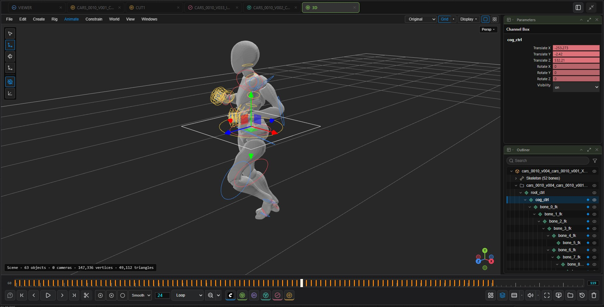

# 3D

[Home](../index.md)

Every 3D tab is a scene. Load a model, add cameras, lights and further models, animate them and render the shot back into the workflow.

## Opening

- Formats: GLB, glTF, FBX, OBJ, STL, PLY, USD (`.usd/.usda/.usdc/.usdz`), Alembic (evaluated per frame) and Gaussian splats (`.spz`, `.splat`, `.ksplat`, `.sog`, splat `.ply`).
- Connect a `MESH` or 3D file to **Send To Image Viewer**, open a model from the file browser or History, or use **Open 3D…** in the lower bar's 3D menu.
- On an **Image Viewer 3D Scene** node, press **Open in Image Viewer**.
- **File ▸ Import Model…** adds models to the scene. An FBX in centimetres comes in scaled to metres (scale 0.01 in the Channel Box; set it back to 1 to undo).

## Navigation

| Action | Input |
|---|---|
| Tumble / track / dolly | <kbd>Alt</kbd> + left / middle / right drag |
| Frame selection | <kbd>F</kbd> |
| Select / move / rotate / scale | <kbd>Q</kbd> / <kbd>W</kbd> / <kbd>E</kbd> / <kbd>R</kbd>; drag on empty space for a box selection, or a lasso (Edit > Tool > Lasso select); Shift toggles, Ctrl takes away |
| World / local axes | <kbd>X</kbd> |
| Show or hide object types (polygons, cameras, joints …) | **Display** menu, <kbd>Shift</kbd>+<kbd>1</kbd>..<kbd>9</kbd>, <kbd>Shift</kbd>+<kbd>0</kbd> (locators) |
| Multi-pane layouts | The layout button on the menu bar switches between one view and the split you used last; its arrow lists every layout. <kbd>Space</kbd> over a pane maximises it |
| Shading | Original, Clay, Normals, Wireframe, **Path traced**; per pane in a split layout |

### Several views

Each pane's menu (its name at the top right) picks what it shows: **Perspective**, **Perspective 2** to **4**, or a flat view (Top, Front, Right, Left, Back, Bottom). So all four panes of the quad layout can be perspective views, each with a camera of its own that remembers where it was.

- **Look through**: a perspective pane can look through any scene camera. Drag a camera from the Outliner onto a pane, or pick it from the pane's **Look through** menu. Navigating in that pane moves the camera. **Own camera** (Free camera in the main view) goes back. A camera dropped on a flat pane turns it into a perspective view.
- **Shading per pane**: the toolbar's Shading, the View menu and the shading keys set the active pane's shading; the pane menu's **Shading** sets any pane's. Panes that differ show their shading under the name. Path traced shading traces one pane at a time: the active pane if it is path traced, else the one traced last. The others draw raster.

The menu bar holds File, Edit, Create, Rig, Animate, Constrain, World, Terrain, View and Windows; each entry shows its hotkey.

## Building a shot

- **Outliner**: the scene hierarchy, with search and type filter. Drag rows to reparent. Every row is a prim of the saved USD stage; its tooltip names the prim path. A model unfolds into **Contents**, the prims inside its file. Hide a prim with its eye, or pick a variant where the file has variant sets. Those changes are saved as overrides in the scene; the model's file is never changed. Right-click a model and choose **Unload** to keep it in the scene without reading or drawing its mesh.
- **Channel Box**: shown in the Parameters panel on a 3D tab. Enter values (relative input such as `+=2` works) or drag a channel name. Several selected objects change together. Its sections fold with a click on their heading: **Transform**, then the object's own properties, named by what it is (**Camera Properties**, **Box Properties**, **Spot Light Properties** ...), then Attributes, Blendshapes and Constraints when it has any. The box remembers which ones are folded. Right-click › **Lock Selected** locks the selected channels: they keep their value whatever moves the object (gizmo, typing, keys), and the gizmo drops that axis. **Unlock Selected** frees them. Locks are saved with the scene.
- **Create**: cameras, lights (point, spot, directional, area, dome), image planes, groups, **locators** and primitives. New objects are placed at the world origin, standing on the grid. History thumbnails dropped into the view become models or image planes; a numbered sequence plays on its plane with the timeline. An image plane's **Path** in the Parameters panel swaps its picture, film or sequence (type a path, or pick one with **…**), and **Frame offset** moves where a film or sequence starts.
- Cameras have a resolution gate when looked through and an optional look-at target. Their parameters (the Parameters panel) hold the lens: **Focal Length**, the **Vertical** and **Horizontal FOV**, the **Film Back** (aperture width and height in mm, or picked from a list of formats), **Film Fit** (how the picture lies on the film back: its width, its height, inside it or around it), **Lens Shift** X and Y (the picture moved off the lens's axis, as a share of its width and height, for straight verticals or an off-centre plate), **Near** and **Far Clip**, and the resolution. The focal length and both fields of view are one number: change one and the others follow, and keying any of them keys the field of view. A new film back keeps the focal length, as changing a camera body would, unless the field of view is keyed. A matchmove's camera comes with the plate's sensor as its film back, so its focal length is the lens's. USD keeps all of it.
- **Framing Mask** in a camera's parameters gives it a mask of its own, drawn in its gate while it is looked through, in a single view or in any pane of a split one: **As the viewer's** (the default) shows the viewer's mask, **off** shows none, and a ratio or **Own ratio…** shows that one, with its **Mask Opacity**.
- A **locator** (a null) is a transform drawn as a cross: something to parent to, aim at, constrain to or key. Its **Size** in the Channel Box sets the cross's size without scaling its children. It saves with the scene and exports to USD as an Xform. Locators are hidden in renders unless helpers are kept.
- <kbd>Ctrl</kbd>+<kbd>Z</kbd> undo, <kbd>Ctrl</kbd>+<kbd>D</kbd> duplicate, <kbd>Ctrl</kbd>+<kbd>G</kbd> group.

## Animation

- <kbd>S</kbd> keys the selection, <kbd>Shift</kbd>+<kbd>W</kbd> / <kbd>E</kbd> / <kbd>R</kbd> key translate / rotate / scale. The key bar in the transport has set key, delete key and autokey.
- **Curve Editor** and **Dope Sheet** (tabs under the viewport): move, scale and ease keys, buffer curves, simplify, pre / post infinity.
- **Anim Layers**: additive or override layers on top of the base animation, with weight, mute, solo, lock and merge.
- **Clip Sequencer**: animation as clips on tracks that can be moved, looped, retimed, matched and blended.
- **Constraints** (Constrain menu): parent, point, orient, scale and aim, with keyable weights. **Bake constraints** converts them to keys.
- **Playblast** renders the active view with a burnt-in HUD.

## Characters

- **Rig ▸ Add controls** builds FK / IK controls on a skinned model. **Auto-rig** (UniRig or SkinTokens) rigs a model that has no skeleton. **Rig ▸ Install AI rigging / motion models…** shows the one command that sets these tools up, with a Copy button. Run it in a terminal on the ComfyUI machine, then press **Check again**. The viewer does not run installers itself.
- **Animation** menu: IK / FK switch and match, space switching, pose library, flip / copy / paste pose, **Pose…** from a text description or a photo, motion from text (Kimodo), motion from video, lip sync from audio, set driven keys, custom attributes, blendshapes and facial controls.
- **File ▸ Export character**: FBX, USD or Alembic with baked motion. **Rig ▸ Add motion from file…** puts motion from FBX, USD or glTF onto a rigged character; a file exported from here restores the full rig.
  - Bones are matched by name, then by humanoid role. A character whose rest pose differs from the file's (an A-pose under a T-pose file) is lined up first, so the motion looks as it does in the file.
  - Pick several files, or a file with several animations, and each becomes a clip in the **Clip Sequencer**, placed one after another or kept as sources. The controls' own keys stay as they were.
- The **Character Picker** panel shows a character's controls as buttons.

## Rendering into the workflow

**File ▸ Render…** sets camera, resolution, frame range, output (MP4 / MOV / WebM or PNG), renderer (raster or path traced, with samples and bounces) and transparent background. The render is written as the next version and added to the graph as a loader node; the 3D Scene node outputs it as `images`.

## Saving and USD

- A scene that belongs to a 3D Scene node is stored in the workflow; **File ▸ Save scene…** writes it to a file, as a USD stage (`.usda` by default, or `.usdc`). The older `.json` scene is still offered but holds no meshes.
- Meshes are referenced, not copied into the stage. A USD model is referenced where it lies. GLB, glTF, OBJ, PLY and STL models are converted once into an `assets/` folder beside the scene, and saving again reuses them. Terrain, scatters, depth meshes, image-plane cards and FBX models are written there from what the view draws. Lights, cameras, image planes and the sky are written as USD lights, cameras and textured cards, and animation is baked into time samples.
- **Open scene…** reads `.usda`, `.usdc`, `.usd`, `.usdz`, Alembic `.abc` and `.json`. A scene saved here opens exactly as it was saved, keys, layers and rigs included. If a model's original file is gone, its copy in `assets/` is used. A stage or cache made elsewhere comes in as items.
- There is no separate USD export: the saved scene is the USD stage, with animation and constraints baked into time samples. USD and Alembic files can also be referenced.

## Terrain and scattering

**Terrain > New terrain** adds a procedural heightfield. **Terrain > Scattering** grows instanced pines, trees, bushes, grass, rocks, columns, lamps or a model of your own on it; a new scatter goes on the selected terrain.

**Terrain > Sculpt** and **Terrain > Paint layer** edit a terrain by hand with a brush: Raise, Lower, Smooth, Flatten (levels at the height where the stroke starts), Restore (back to the generated ground) and Paint (lays down the ground, rock, cliff or peak layer over what the slope and height rules give). <kbd>Ctrl</kbd>+drag turns Raise into Lower and back, and Paint into erase. The bar over the view switches tools and sets size, strength and hardness; <kbd>[</kbd> <kbd>]</kbd> size the brush, <kbd>Esc</kbd> stops. Each stroke is one undo step, and scatters on the terrain follow the new ground. **Clear sculpting** and **Clear layer paint** undo all of it.

**Terrain > Erode…** wears a terrain down the way weather does, live in the view. Rain falls, runs downhill, picks up ground where it flows fast and steep and drops it where it slows; ground steeper than the slope angle slides down. Choose water, sliding or both, set the number of steps and how strongly each part acts, and press **Run**; you can pause, change settings while it runs and go on, or **Reset** to the terrain as it was. It runs on the GPU (WebGL2 with float render targets) and falls back to a slower CPU version otherwise; the box says which. **Apply** keeps the result as the terrain's sculpting, in one undo step, so **Clear sculpting** takes it off again. Apply can also paint the rock layer where water wore the ground away and the ground layer where it laid sediment down, and set each scatter on the terrain to grow on wet, dry, laid-down or worn ground, or along the water's paths. **Cancel** puts the terrain back. Scatters stay where they are while it runs and follow the ground on Apply.

**Scattering > Paint scatter** paints where the selected scatter grows. Left drag paints, <kbd>Ctrl</kbd>+drag (or Erase) takes paint away, <kbd>[</kbd> and <kbd>]</kbd> size the brush, <kbd>Esc</kbd> stops. The bar over the view sets size (metres), strength and hardness. Once painted, the scatter only grows where there is paint, and as thickly as the paint says: *Count* is how many would grow if the whole terrain were fully painted, so raise it for a denser patch. Painting one area never moves the instances elsewhere. Each stroke is one undo step. **Clear scatter paint** lets it grow everywhere again.

With agentY installed, the agent can do all of this too: ask it for a terrain, a road or a ridge, a scatter, or an erosion pass, and it works in the open 3D tab as you would, one undo step per stroke.

## Matchmove

A matchmove finds the camera that filmed a plate, so 3D can be put into the shot. Open it from the **Matchmove** menu in the 3D menu bar, or from the Matchmove group in the lower bar. It works in a 3D tab with two panels: the **Matchmove** guide, which takes you through the shot step by step, and the **Plate**, where the tracks are drawn over the picture.

1. **Plate**: a film, or one frame of a numbered sequence (the whole sequence is taken). The focal length and sensor are read from the file's metadata or from a camera file beside it, where there is one; a phone's field of view comes from its own 35 mm equivalent focal length. Or pick the camera from the list (cinema and photo bodies, anamorphic, iPhone lenses by their 35 mm equivalent). **Pixel aspect** is a pixel's width over its height: 2 for a 2× anamorphic squeeze. iPhone films and HEIC photos are read directly (see *From an iPhone* below).
2. **Lens**: the distortion, as the same two numbers (k1, k2) and centre the Comp's Lens Distortion node uses. Measure it from a grid or checkerboard shot with the same lens (no chart at hand? **Show a chart to film…** puts a checkerboard full screen on this monitor or a tablet: film it close enough that the squares reach the corners of the picture), or from lines that are straight in the world (draw them with **Lines** in the Plate panel). The lens can be taken from a Comp file or sent to one as a Lens Distortion node (undistort or redistort), and written as an ST map.
3. **Masks**: areas the tracker stays out of (people, reflections, the sky), keyed over time. A mask can also mark a moving object. **Mask with AI** makes one over the whole shot in one ComfyUI job: SAM 3 finds what you name ("person", "car", "water") on each frame, or a background remover takes the subject. Run it on every frame or every second or third (a frame in between uses the one before); a background remover that reads video (Bria's, through ComfyUI's partner nodes, up to 60 s) takes the shot as one film instead, so its mask does not flicker from frame to frame; grow and invert it in the mask's row. The models are offered for download when they are missing. **Model at** runs the model on a half- or quarter-size copy of the plate, which is quicker and lighter on memory; the mask still comes back at the plate's size, a little softer at the edges. The same setting in the Scene step (**Models at**) applies to Find with AI and Find with depth.
4. **Track**: automatic tracking over the shot, plus tracks added by hand. Tracks are listed worst first; pick them in the list or on the plate, and delete or trim them.
5. **Solve**: the camera, and the focal length when it is not known; a focal length from the camera is the start and is refined (choose **Keep it fixed** to hold it). A camera that only turns is solved as a tripod. The error per track and per frame shows what to fix. **Measurements** keep the shape true: pick tracks in the Plate panel (click, Shift+click, a box, or the **Lasso**; Ctrl takes away) and say what they are - a **Distance** in metres between two, three or more **On a plane** or **On a line**, or a **Right angle** (end, corner, end, in that order). Distances make one unit a metre; two in different directions, or a right angle, stop a solve from coming out squashed or stretched. After the solve each measurement says how well it holds, and **Proportions** says whether the shot pins its focal length down: when it does not, or another focal length fits better, the depth can be off, and measurements or the camera's real focal length are the cure. The clean-up buttons leave measured tracks alone.
6. **Objects**: a moving object's own tracks, solved against the camera.
7. **Scene**: the camera, keyed on every frame, goes into the scene with the undistorted plate behind it and the solved points as locators. The plate follows the timeline frame by frame; select it and change its **Path** in the Parameters panel to put another plate (a cleaned or graded version) on the same camera. Then set the ground, which makes the world level and puts the floor at height 0: **Find the ground** looks for the lowest wide level surface among the solved points (with the cameras above it), **Draw the ground** takes the points inside a shape you click round the floor in the Plate panel (<kbd>G</kbd>), and **Find with AI** has SAM 3 look for "ground" (or your words: floor, road, grass) on a few frames and uses the tracks that stay on it. **Find with depth** runs a depth model (Depth Anything 3) on a few frames and finds the floor in its depth, so a plain or shiny floor the tracker could not hold on to still counts; with the Metric model and **metres** on, the world is also scaled so one unit is a metre, and the guide says how high the camera stands above the floor. A Cinematic iPhone film has **Find with the phone's depth**, which uses the film's own depth in place of a model. The points it used are picked, so strays can be unpicked; **Raise** / **Lower** move the floor and **Flip** turns a ground found from below. Or pick points by hand to set the floor, the origin, an axis or the scale, and add a plane or a box on them.

The work is kept in a `.mm.json` file beside the shot's other files, saved as you go; the scene remembers it.

### From an iPhone

Take the original file off the phone (in Photos: *Export Unmodified Original*). An edited or re-exported copy loses most of the following.

- **Films (.MOV)**: the model, the lens ("back dual wide camera 5.7mm f/1.5") and the 35 mm equivalent focal length give the focal length and the sensor. The Solve step is then set to *Refine it*, because the phone stabilises and lens-corrects its film, which crops it a little. A film shot upright is stored on its side and is turned upright here. The guide's *From the phone's film* box lists the lens, the iOS version and the timed metadata the film carries.
- **Cinematic mode** also records a low-resolution depth track (a few hundred pixels wide) beside the picture. **Show the depth** draws it for the current frame, **Save the depth as pictures** writes it as a 16-bit picture sequence (bright = near), and **Find with the phone's depth** in the Scene step finds the floor in it. Its values have no unit, so they are scaled onto the solved tracks frame by frame, and the world is not scaled to metres.
- **Photos (.HEIC)**: the picture (turned as the phone shows it), the camera facts from its EXIF and, for a Portrait photo, its depth picture are copied into `input/matchmove/phone/`. The copy is the plate.
- What the stock Camera app does not record: depth in normal video, slow motion, time-lapse or ProRes; gyro or motion samples; LiDAR depth.

With agentY installed, the agent can do every step too (its `matchmove` tool), and reads the same numbers you see - tracks a frame, the solve's error, the worst tracks - to judge the track as it goes.

**The plate in the main view**: the Plate panel's **⇄ Main view** button, the main view's switch (left of its name) or **Matchmove ▸ Plate in the main view** shows the plate in place of the 3D view, and back. It works as it does in its panel; it goes with the 3D tab and comes back with it.

In the Plate panel: the wheel zooms, the middle button or <kbd>Alt</kbd>+drag pans, <kbd>F</kbd> fits. <kbd>Q</kbd> select, <kbd>T</kbd> add a track, <kbd>M</kbd> draw a mask, <kbd>L</kbd> draw a line, <kbd>G</kbd> draw round the ground; <kbd>Enter</kbd> finishes a mask, line or ground shape, <kbd>Esc</kbd> cancels. <kbd>Delete</kbd> removes the picked tracks, <kbd>[</kbd> and <kbd>]</kbd> trim them before or after the frame shown, <kbd>O</kbd> switches them on or off, <kbd>Ctrl</kbd>+<kbd>A</kbd> picks every track on the frame. <kbd>Ctrl</kbd>+<kbd>Z</kbd> undoes.

## Atlas and Echo worlds

With agentY installed, the World menu generates a world from text or images (World Labs Atlas or SpAItial Echo), repaints the current view (Chisel), orients the result and exports it as a Gaussian splat.

## Limitations

OBJ files are shown without their `.mtl`; Draco- and KTX2-compressed glTF files do not load. USD is displayed through a flattened proxy without materials. FBX models and rigs are saved into a scene as a still mesh in their bind pose. Splats are not path traced.
