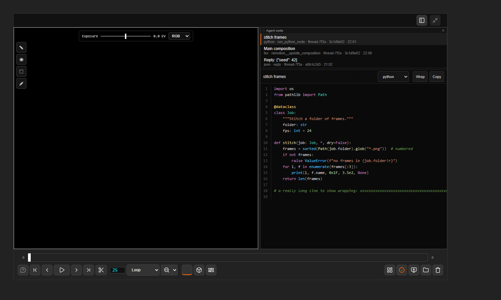

# Agent code

[Home](../index.md)

A read-only panel for code produced by agentY: scripts it runs, files it writes and code blocks in its replies. Syntax highlighting, line numbers, **Copy** and **Wrap**.

- **ComfyUI ▸ Agent code** in the lower bar opens the live feed: the list of snippets (newest first) and the selected one. A dot on the ComfyUI button marks new code.
- Double-clicking a text or code file in the file browser opens it in its own tab; several can be open at once.
