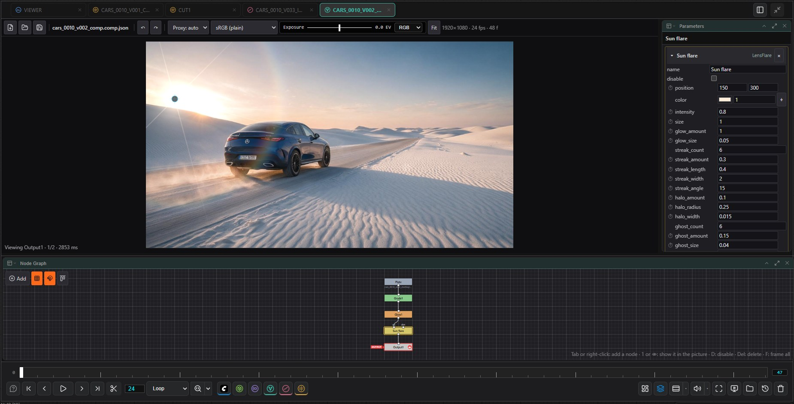

# Comp

[Home](../index.md)

A node-based compositor for stills, films and image sequences. It works in linear, premultiplied float, and every parameter can be keyed. A comp is a file (`*.comp.json`); its nodes are independent of the ComfyUI graph.

## Opening

- **Open Comp…** or **New comp** in the lower bar's Comp menu. With a shot context on the canvas, a new comp is created in that shot's `comps` folder.
- Double-click a `*.comp.json` in the file browser.
- The bar above the picture has New, Open and Save; Save's menu holds Save as…, the renders, the farm, the script export, and Relink / Localise footage.
- Unsaved changes are kept aside every 30 seconds. If the viewer closes before you save (a crash, a closed tab), opening the comp again offers them back.

## The node graph

The graph flows from top to bottom: inputs on the top edge of a node, the output at the bottom.

| Action | Input |
|---|---|
| Add a node | <kbd>Tab</kbd>, **Add** or right-click, then type to search |
| Connect / disconnect | Drag from an output to an input / drag an input away |
| Insert into a connection | Drop a free node onto the wire |
| Cut connections | Hold <kbd>Y</kbd> and drag across wires |
| Arrange in a row or column | Hold <kbd>A</kbd> and drag |
| View a node | <kbd>1</kbd>, or the eye on its right edge |
| Disable / delete / frame all | <kbd>D</kbd> / <kbd>Del</kbd> / <kbd>F</kbd> |
| Grid / snap | <kbd>G</kbd> / <kbd>S</kbd> |
| Duplicate the selection | <kbd>Ctrl</kbd>+<kbd>D</kbd>, or hold <kbd>Alt</kbd> and drag a node away |
| Copy / cut / paste | <kbd>Ctrl</kbd>+<kbd>C</kbd> / <kbd>Ctrl</kbd>+<kbd>X</kbd> / <kbd>Ctrl</kbd>+<kbd>V</kbd> (lands under the pointer); <kbd>Ctrl</kbd>+<kbd>Shift</kbd>+<kbd>V</kbd> also keeps the inputs from nodes that were not copied |
| Add footage | Drop History thumbnails, file browser rows or files from the desktop on the graph: a Read each |
| Group the selection / take a group apart | <kbd>Ctrl</kbd>+<kbd>G</kbd> / <kbd>Ctrl</kbd>+<kbd>Shift</kbd>+<kbd>G</kbd> |
| Go into a group / back up | Double-click it or <kbd>Ctrl</kbd>+<kbd>Enter</kbd> / <kbd>Ctrl</kbd>+<kbd>Backspace</kbd> or the path at the top |
| Backdrop round the selection / Dot | <kbd>B</kbd> / <kbd>.</kbd> |

Copies keep the connections and expression links among themselves; groups and backdrops (with what lies on them) are copied whole, an Output never. What was copied can be pasted into another comp or into a group.

The selected nodes' parameters appear in the **Parameters** panel, one section per node, and their handles are drawn over the picture (transform jack, crop box, flare position). **Layers** and the **Curve Editor** sit behind the graph as tabs. The graph can also be shown in ComfyUI's bottom panel (**Comp** tab).

## Layers

The same graph as a stack of layers on a timeline: each Merge on the main pipe is a layer, its A input the layer's picture. A layer row has the visibility switch, the merge operation and the opacity on the left, and on the right a bar from the layer's first to its last frame. Outside its bar the Merge passes its B input unchanged. A Read's footage is drawn as a dashed band behind the bar.

A Read that is in the graph but not part of the picture yet is listed below the layers; **+ layer** puts it on top. While nothing is wired into the Output, the panel shows the layers that lead to the node you are viewing (or the largest unconnected tree), and **Wire into the Output** connects it.

| Action | Input |
|---|---|
| Slide a layer (footage and keys move with it) | Drag the middle of its bar |
| Trim the start / end | Drag an end of the bar (snaps to the playhead, <kbd>Shift</kbd> to place freely) |
| Trim the start / end to the playhead | <kbd>[</kbd> / <kbd>]</kbd> |
| Show the animated parameters | The arrow left of the layer: one row per keyed parameter of the Merge and its A branch |
| Select keys | Click; <kbd>Shift</kbd> toggles, <kbd>Ctrl</kbd> removes, <kbd>Ctrl</kbd>+<kbd>Shift</kbd> adds; drag a box on empty lanes; <kbd>Ctrl</kbd>+<kbd>A</kbd> |
| Move keys | Drag them, or <kbd>,</kbd> / <kbd>.</kbd> (<kbd>Shift</kbd>: 10 frames) |
| Delete keys / interpolation | <kbd>Del</kbd> / right-click a key |
| Move time | Click or drag in the ruler, or click an empty lane |
| Zoom | <kbd>Ctrl</kbd>+wheel, or − / + / Fit in the bar |

A layer's frames are the Merge's `in` and `out` in the file (`out` is the first frame without the layer); the script export turns them into an expression on the Merge's disable.

## Keeping a graph tidy

- **Groups** hold a graph of their own. Inside, each **Input** node is one of the group's inputs (in their order) and the **GroupOutput** is what it passes on. A disabled group passes its first input. Node names inside a group are its own; another group may use the same ones.
- **Tools**: a group's right-click menu (or its Parameters) has **Save as a tool…**. Tools are kept per user in `~/.comfyui_image_viewer/comp_tools/` (or the folder named by `IMAGE_VIEWER_COMP_TOOLS`) as `*.comp.json` files, so every comp on the machine can use them; they are listed under **Tools** in the <kbd>Tab</kbd> menu, where the × removes one.
- **Backdrops** are coloured, labelled areas. Dragging the label moves the nodes on it; the corner resizes it. **Sticky notes** hold text (double-click to write). Neither takes part in the picture.
- **Dots** bend a wire; they pass their input on.
- A node's **name and colour** are in the header of its panel in Parameters: click the name to change it (empty gives its id back), click the swatch to pick its colour in the graph, ↺ to get its own colour back. **Colour…** in the right-click menu does the same.

## Expressions and links

Any keyable number, position or colour can be worked out instead of set: click **=** at the end of its row in Parameters. A position or colour has a line per component; an empty line leaves that component alone. A node with expressions shows **=** in the graph, and a dotted line comes from each node it reads.

| | |
|---|---|
| Names | `frame`, `time` (seconds), `fps`, `width`, `height`, `value` (the number without the expression), `pi`, `e` |
| Operators | `+ - * / % ^`, `== != < <= > >=`, `&& \|\| !`, `a ? b : c` |
| Functions | `sin cos tan asin acos atan atan2 sqrt abs exp log log10 pow floor ceil round fract sign min max clamp lerp mix smoothstep step mod degrees radians if random noise` |
| Other nodes | `Blur1.size`, `Transform1.translate.x`, `Grade1.color.r`; `'Odd name'.mix` for an id with spaces. A node is looked up in the same graph first, then in the graphs around it. |

The **⇢** row links the number to another node's with a scale and an offset (it writes `Node.param * scale + offset`). **Bake to keys** turns the expression into a key on every frame; **Take off** removes it. Expressions are a small calculator: they cannot run code, read files or reach anything outside the comp. The script export writes an expression's values as keys.

## Nodes

| Category | Nodes |
|---|---|
| Input / output | Read, Constant, Roto (drawn with the viewer's Roto tool), Paint, Write, Metadata, Output |
| Merging | Merge (over, plus, multiply, screen, in, out, atop, mask, stencil …), Copy, ChannelMerge, ChannelMath |
| Geometry | Transform, Reformat, Crop |
| Warping | CornerPin, STMap, VectorWarp, GridWarp, LensDistortion |
| Tracking | Tracker (1–4 points), PlanarTracker |
| Colour | Grade, ColorCorrect (per-range HSL / RGB, hue wheels, two secondaries), CDL, LUT, HueCurves, Clamp, Log2Lin, ColorMatch, OCIOColorSpace, OCIODisplay |
| Keying | Keyer, LumaKeyer, ChromaKeyer, DifferenceKeyer, Despill, CoreEdge, EdgeExtend, LightWrap, Erode/Dilate, Premult, Unpremult |
| Filter and light | Blur, MotionBlur, DepthBlur, Defocus, Glow, LensFlare, Laplacian, Grain, Denoise, Sharpen, Median, EdgeDetect, EdgeBlur |
| Time | Retime (nearest, mix or vector blend), Vectors (optical flow), FrameHold, FrameRange, TimeOffset, AppendClip, TimeBlur |
| Channels | Shuffle, AddChannels, Remove |
| 3D | Camera, Card, Geometry (cube, sphere, cylinder), Scene, Project, PointCloud, Render |
| Deep | DeepRead, DeepFromImage, DeepMerge, DeepHoldout, DeepCrop, DeepFlatten |
| Views | OneView, JoinViews, Anaglyph, SideBySide |
| AI | AI Matte, AI Depth, AI Relight, AI Inpaint, AI Upscale |
| VFX | VFX Alpha Matte, VFX SDR to HDR, VFX Reframe, VFX Upscale |
| Graph | Group, Input, GroupOutput, Dot, Backdrop, StickyNote |

Most colour, filter, keying and channel nodes have a **mask** input (the last one) and a **mix**. Mix 0 passes the input through unchanged; with a mask connected, the node acts only where the chosen mask channel (alpha by default, or any extra channel such as `mask.a`) is above 0, and **invert mask** flips that. The mask's channel and invert rows appear once something is plugged into the mask input. A mask of another size is aligned at the bottom-left corner, like any other image.

## Footage

- A Read takes stills, films, image sequences (`shot.####.exr`, `shot.%04d.exr`) and other comps (`*.comp.json`): a comp read this way is rendered as it stands, so a precomp updates whenever it is saved.
- A new Read starts empty. **Open** beside its File parameter brings up the system's file dialog when the browser runs on the ComfyUI machine; from another machine it opens the viewer's file browser, which is also what **…** does. Picking one frame of a sequence takes the whole sequence. Files dropped from the desktop are copied into ComfyUI's input folder first.
- A sequence with holes in it is fine. The Read's **Missing frames** setting picks what a hole shows: black, the nearest frame before it, or an error that stops the render.
- **Show metadata** on a Read, Write or Metadata node lists what the image carries at the current frame: the file's own header (EXR attributes, film tags), timecode, and anything set further up. A **Metadata** node sets keys (`key = value`, `[frame]` is the frame number) or removes them (`exr/*` patterns work).
- **Relink footage…** looks for missing files by name under a folder you pick (a sequence by its name around the frame number) and points the Reads at them, as one undo step.
- **Localise footage…** copies the footage of the Reads into a local cache and uses the copies from then on; the Read keeps its original path, and a copy is refreshed when the original changes.

Each image keeps its own resolution; images of different sizes are aligned at the bottom-left corner. Extra channels (`depth.z`, `mask.a` …) travel down the graph with the image.

A few notes on the newer nodes:

- **DifferenceKeyer** keys against a clean plate on its second input. **Despill** pulls the screen colour back and can put a replacement colour in its place. **CoreEdge** splits a matte into a solid core and a soft edge; **EdgeExtend** pushes the colours inside a matte outwards so a soft edge has the right colour under it; **LightWrap** lets the background bleed over the foreground's edge.
- **Grain** is seeded per frame. With a plate on its second input it measures how strong that plate's grain is and scales its own to match. **Denoise** is an edge-preserving guided filter.
- **TimeBlur** averages frames across a shutter; **AppendClip** plays one input after the other with an optional dissolve. Retime's **vectors** blend warps the two frames on either side along their optical flow.
- **CDL** applies slope, offset, power and saturation, forwards or inverse. Its Parameters section reads a `.cc`, `.cdl` or `.ccc` (the first correction) and writes one next to the comp. **LUT** reads a `.cube` file directly; with OpenColorIO on the server it also reads `.3dl`, `.spi3d`, `.csp`, `.clf` and the other formats OCIO knows. **Log2Lin** converts between scene-linear and Cineon, LogC3, S-Log3 or ACEScct.

### AI nodes

AI nodes send the image coming into them through a ComfyUI workflow and keep the answer. They use the same workflows as Paint's Generate, so the workflow picked there for background removal, image edit, fill / remove or upscale is the one that runs (Matte uses background removal, Depth and Relight an image edit with words, Inpaint fill or remove inside the alpha of its mask input, Upscale the upscalers).

Nothing runs by itself. In the node's Parameters section, **This frame** runs it on the frame at the playhead and **All frames** on every frame, one after the other. Each answer is saved next to the comp as `<comp>_ai/<node>/<node>_<kind>.<frame>_<run>.png` and stored in the node, so it travels with the comp (one undo step per frame). A frame without its own result shows the nearest earlier one; before the first run the node passes its input through. When the input or the prompt changes afterwards, Parameters marks the results as out of date; they stay until they are run again. **Forget** removes them from the node and leaves the files.

### VFX nodes

The VFX nodes are the History's **Convert Footage** passes as nodes: **VFX Alpha Matte** (a matte of the main subject; output premultiplied or the matte as grey), **VFX SDR to HDR** (the scene-linear ACEScg EXR frames), **VFX Reframe** (outpaints into a new frame size, snapped to 64) and **VFX Upscale** (refine or restore, FullHD or 4K). They run the same LTX-2.5 workflows, which work on a whole clip at once and take minutes on the GPU, so a VFX node is never worked out live: it is rendered once and then read back like footage.

**Render** in the node's Parameters section runs it over the comp's frames. The workflows take 8n + 1 frames, so a few frames at the end can be left out; the alpha matte runs in parts of at most 121 frames, joined afterwards. The result lands next to the comp in `<comp>_vfx/<node>/` (a film, or for HDR the EXR sequence) and is stored in the node. Over the frames it covers the node shows the result; outside them, and before it has been rendered, it passes its input through. Reframe and Upscale take the size of their result. Stop cancels a run, Forget takes the result off the node and leaves the files. When the input or a setting changes afterwards, Parameters marks the result as out of date until it is rendered again.

**Prerender** decides what goes into the workflow:

- **on** (default): what comes into the node, everything in the comp up to there, is rendered to a film first, and that film goes through the workflow.
- **off**: the film of the Read coming in is used as it is. This is quicker and uses the plate's own pixels, but the input must be a Read of a film with nothing but Dots in between. The result follows the Read's offset.

## Working speed

Every node's result is kept in memory while you work (up to about 640 MB). Changing a node remakes only what lies downstream of it, and a frame you have already seen comes back at once. Each image also knows the box its visible pixels lie in, so a small element, roto shape or blurred patch over a large plate is only worked out inside that box (about eight times faster for a small blurred element over a 1080p plate). When nothing else is happening, the next frames of the picture on screen are rendered ahead. Frames that are ready are marked on the timeline, so playback over them runs at speed. The proxy menu in the bar sets the working resolution; the render is always full size.

The **GPU** button in the bar (on by default) works the per-pixel nodes on the graphics card: Constant, Merge, Grade, Premult, Unpremult, Transform, Reformat, Crop, Blur, and the mask and mix of any node. Other nodes and footage are still prepared on the CPU and passed in. When you zoom in so that only part of the picture is on screen, only that part is worked out (the region of interest), and panning beyond it works out the new part. A comp that carries extra channels, or has views, stays on the CPU. The info line under the picture shows which path made the frame.

## Paint

The Paint node lays strokes on the picture that comes into it. Select it and its section in **Parameters** holds the tools, the brush and the list of strokes; drag on the picture to paint.

| Tool | What a stroke does |
|---|---|
| Brush | Paints a colour |
| Clone | Copies the picture from another place: <kbd>Alt</kbd>+click sets where from, the offset is kept for the next strokes. *From frame* copies from another frame (-1: the one before) |
| Reveal | Paints the node's second input (**reveal**) through, with the same offset and frame settings |
| Eraser | Removes colour and alpha |
| Select | Click a stroke to edit it; <kbd>Del</kbd> deletes it |

Each stroke has its own size, hardness, opacity and spacing, and lives on **all frames**, **this frame**, **from here on**, **up to here** or a range of frames. A stroke can **follow** a Transform node: it moves with that node's animation, counted from the frame it was painted on. <kbd>[</kbd> and <kbd>]</kbd> change the brush size. Strokes are stored in the comp and rendered on the server like every other node.

## Viewer tools

The **Viewer** menu in the bar holds the tools for looking at the picture. None of them changes the comp or the render.

| Tool | Use |
|---|---|
| Compare | Select a node and press <kbd>2</kbd> to make it **B** (tagged in the graph). The picture shows A (the viewed node) against B as a **wipe** (drag the handle; <kbd>Shift</kbd>+drag turns the line, double-click centres it), their **difference** or a 50 % **mix**. <kbd>W</kbd> on the picture turns the wipe on and off |
| Pixel sampler | <kbd>I</kbd>. Shows the values under the pointer in the working space (premultiplied and straight) and as displayed; <kbd>Shift</kbd>+drag a box for its mean, minimum and maximum |
| Scopes | Histogram, waveform (click it to switch between luma and RGB) and vectorscope, read from the picture as displayed |
| Out-of-range colours | Stripes over values above 1 (red) and below 0 (blue), yellow for an alpha outside 0–1; the info line counts the pixels |
| Guides | The format's box (anything outside it is overscan), action safe (93 %) and title safe (90 %), and the centre |

The sampler and the scopes read the preview at its proxy size.

## Tracking and warps

- **Tracker**: **+ Point**, then click the picture. Each point has a pattern box (what is followed) and a search box (how far it may move in a frame), sized in its panel; dragging a point on the picture keys it there at the current frame. The arrows in its panel track one frame or to the end, either way; tracking runs on the server at full resolution and the keys appear as they come. A point whose match falls below a threshold stops there. The node itself can stabilise or match-move (translate, rotate, scale or perspective, from the points it has), or hand that over to a new node: **Make** builds a keyed Transform or CornerPin beside it.
- **PlanarTracker**: **Place surface**, drag its four corners onto a flat surface, then track. The corners follow the surface as a whole, so it keeps going when parts of it are covered. **Make** gives a keyed CornerPin.
- **CornerPin**: drag the squares (where the corners go) and the rings (the points they come from). Corners count 1 bottom left, 2 bottom right, 3 top right, 4 top left.
- **STMap / VectorWarp**: move the picture by a map from a second input: absolute UV coordinates (0–1, bottom left origin) or pixel offsets.
- **GridWarp**: a source and a destination grid; drag the destination points, Shift+drag the source points. The warp is smooth between them.
- **LensDistortion**: undistort or redistort with k1 / k2 about a centre, or output the matching ST map. **Draw lines** along things that are straight in the world (double-click ends a line), then **Solve** finds the coefficients.

## 3D

A small scene renderer inside the comp: Y up, the camera looking down -Z, rotations in degrees applied X, then Y, then Z.

- **Card** puts an image on a plane (its height follows the image's aspect); **Geometry** wraps an image, or plain white, round a cube, sphere or cylinder. Both have translate, rotate, scale and a uniform scale.
- **Project** paints an image onto whatever it is attached to, from a Camera; *front* keeps it off faces turned away from that camera.
- **PointCloud** turns an image and its depth channel (`depth.z` by default, read as distance or 1 / distance) into points seen from a Camera.
- **Scene** gathers up to four of these; **Render** draws a Scene (or one piece) through a Camera over an optional background, with 1 to 4 samples per pixel each way. It writes `depth.z` too. Fed into a Deep node, it gives one sample per object per pixel.
- **Camera** has a focal length and a film back, near and far planes, and an interaxial and convergence for stereo. Its **import** row takes keys from a camera of a shot open in a 3D tab (place, turn and lens, one key a frame) or from a camera text file: `.chan`, one line a frame with `frame tx ty tz rx ry rz` and optionally the vertical field of view.

## Deep

A deep image holds any number of samples per pixel, each a premultiplied colour at a depth. **DeepRead** reads the first deep part of an OpenEXR file (R G B A Z ZBack; a missing A counts as 1). **DeepFromImage** makes one sample per pixel from a flat image and its depth channel, or at a set depth. **DeepMerge** combines up to four, **DeepHoldout** dims one by what another has in front of it, **DeepCrop** keeps the samples between two depths (or outside them), and **DeepFlatten**, or any flat node after a deep one, lays them front to back. A sample's back depth is kept but not used to split it.

## Views

The view menu in the bar turns a comp into a stereo pair (left, right) or any list of views; the picture shows the view picked there. Then:

- `%V` in a Read's file name stands for the view's name and `%v` for its first letter, so one Read reads a file per view.
- **Split** in a node's parameters gives it different settings in the view on show; **Join** takes them away.
- A Camera's eyes sit interaxial apart, with zero parallax at the convergence distance.
- **OneView** picks a view, **JoinViews** takes a different input per view, **Anaglyph** and **SideBySide** show two views in one image.
- **Render…** writes every view, each as its own versioned output named `<name>_<view>`.

## Colour

The working space is the scene-linear role of the OCIO config. The display menu in the bar views the image through any display / view of the config; the viewer's exposure and channel controls also sit in the bar and only affect the display.

## Output

- **Render…**: every still format of the Send To Image Viewer node (PNG, EXR, TIFF …) or an MP4 / MOV / WebM film, rendered at full resolution on the server. The result is versioned, added to the History and placed on the canvas as a loader node.
- **Write nodes** write files from anywhere in the graph, each with its own path, format and frame range. A path may hold `####` (the frame number at the node's padding), `{comp}`, `{name}` and `{version}`; a relative path lies beside the comp, and an empty one gives `<comp>_<name>/<name>.####.exr` there. EXR is written as half or full float with ZIP, ZIPS or no compression; **Channels: all** puts every extra channel into the same file as its own layer. Handles add frames on each side of the range, and the file numbers follow the comp frames (comp frame 0 is the first number, 1001 by default). Timecode and the image's metadata go into the EXR header. **Render Write nodes…** renders the ticked ones in one pass.
- **Send to the farm…** sends the Write nodes to the render farm (Deadline) through agentY, as one job split into chunks of frames; the dialog warns about any comp, footage or output path that only this machine can see.
- **Script export** (Save menu): writes an `.nk` script. Nodes with a direct equivalent are translated; the rest are rendered to EXR sequences next to the script and read back in. Cameras, 3D pieces and deep nodes only appear as part of the image rendered from them.

## Scripting

Comps can be built and rendered without the viewer:

- `python scripts/comp_render.py shot.comp.json` renders every Write node; `--writes`, `--first`, `--last`, `--handles`, `--frames 1001-1010 --frame-offset 1001` (one farm chunk) and `--output out/shot.####.exr` (the Output node) narrow it, and `--list` prints what would be written. Use ComfyUI's Python; nothing of ComfyUI itself is loaded.
- `src/comp_api.py` is the Python API behind it: `Comp.open` / `Comp.new`, `add`, `connect`, `set`, `key`, `remove`, `apply(ops)` (a list of edits, all or nothing), `save`, `render`, `render_output`.
- agentY has the same edits as tools (create, read, edit, render, send to the farm); an open comp tab takes the agent's changes in at once.

All nodes are written from published formulas and observed behaviour; no third-party code or assets are used.
