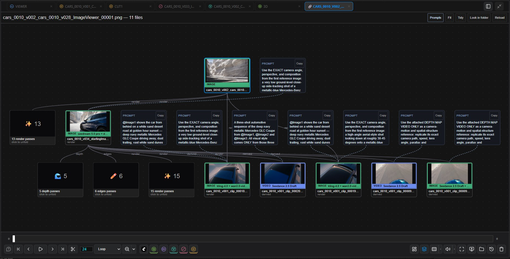

# Dependencies

[Home](../index.md)

What a file was made from, and what was made from it, as a graph: inputs above, results below. Right-click a History thumbnail ▸ **Show dependencies**.

The Send To Image Viewer node and agentY record this when they save. Files saved by other nodes with their workflow inside (Save Image, Save Video, VHS Video Combine) are worked out the first time you look. It runs in ComfyUI, without agentY.

- Each node is a file: green frame for a still, blue for a video, with the model it was made with underneath (hover for all of them). A file without a graph shows what its C2PA credentials or a Magnific download say.
- **Prompts** sit above the files they made, with **Copy**. A file made from an older input is marked **out of date**.

| To | Do |
|---|---|
| Open / centre a file | Click / double-click it |
| Loader node on the canvas | Right-click ▸ **Drop into canvas** |
| The workflow it was made with | Right-click ▸ **Open its workflow** |
| Select several | Drag a box; <kbd>Ctrl</kbd>+click toggles |
| Pan / fit | Middle drag or <kbd>Space</kbd>+drag / <kbd>F</kbd> |
| Find files from before the record | **Look in folder** |

The records are small JSON files in an `agent_metadata` folder beside the files, the same ones agentY reads.
