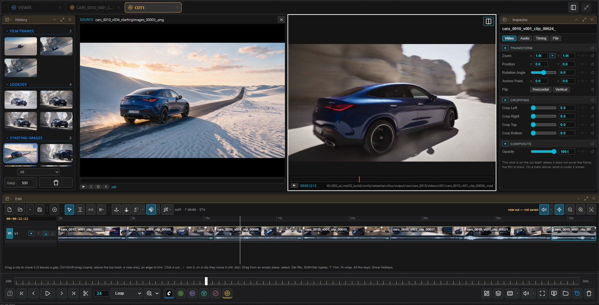

# Edit

[Home](../index.md)

A multi-track editor. A cut is an OpenTimelineIO file (`.otio`) and plays in its own tab straight from the source media; nothing has to be rendered first.

## Opening a cut

- **Open Edit…** in the lower bar's Timeline menu.
- **Open cut…** (<kbd>Ctrl</kbd>+<kbd>O</kbd> with the timeline focused, or the folder button on the Edit bar), or double-click a `.otio` in the file browser.
- If a film has a `.otio` of the same name next to it, the timeline button in the transport lights up and opens that cut.

The Edit, Inspector, Effects and Mixer panels are only shown while a cut's tab is active.

## Tracks

| Track | Content |
|---|---|
| V1 | The main sequence: shots back to back, with dissolves and gaps |
| V2 and up | Clips placed at a time. A clip covers picture and sound of everything below it. Titles live here |
| A1 | The music bed |
| Sound tracks | Audio clips placed at a time |

Each track header has enable, solo, lock and the auto track selector. Shift + mouse wheel changes track height.

## Adding clips

- Drag History thumbnails, file browser rows, desktop files or canvas nodes onto the timeline.
- **Add ▸ Files…** and **Add ▸ Selected canvas nodes** perform an insert edit at the playhead.
- Dropping above the top track or below the bottom track creates a new track.

## Editing

| Mode | Key | Clip edge | Clip body |
|---|---|---|---|
| Selection | <kbd>A</kbd> | Trim without ripple (leaves a gap) | Overwrite move |
| Trim | <kbd>T</kbd> | Ripple trim | Upper half slip, lower half slide |
| Blade | <kbd>B</kbd> | – | Split at the click |
| Dynamic trim | <kbd>W</kbd> | <kbd>J</kbd> / <kbd>L</kbd> move the selected edit point at playback speed | – |

The centre of an edit point rolls it. <kbd>,</kbd> / <kbd>.</kbd> nudge by one frame, <kbd>N</kbd> toggles snapping. In Trim mode the outgoing and incoming frames are shown side by side.

| Action | Key |
|---|---|
| Split at the playhead | <kbd>Ctrl</kbd>+<kbd>B</kbd> |
| Lift / ripple delete | <kbd>Del</kbd> / <kbd>Shift</kbd>+<kbd>Del</kbd>; with in/out set and nothing selected, lift or extract the range |
| Disable clip | <kbd>D</kbd> |
| Mark in / out | <kbd>I</kbd> / <kbd>O</kbd>; <kbd>X</kbd> marks the clip |
| Retime / loop | <kbd>Alt</kbd>+drag an edge / <kbd>Ctrl</kbd>+drag the out edge |
| Match frame / reverse match frame | <kbd>F</kbd> / <kbd>Shift</kbd>+<kbd>F</kbd> |
| Still frame from the playhead | <kbd>G</kbd>; <kbd>Alt</kbd>+<kbd>G</kbd> also inserts it at the playhead |
| Marker | <kbd>M</kbd>; on an existing marker it opens name, colour and notes |
| Swap with neighbour | <kbd>Ctrl</kbd>+<kbd>Shift</kbd>+<kbd>,</kbd> / <kbd>.</kbd> |
| Select forward | <kbd>Y</kbd> (<kbd>Alt</kbd>: all tracks) |
| Copy / paste attributes | <kbd>Ctrl</kbd>+<kbd>C</kbd>, <kbd>Alt</kbd>+<kbd>V</kbd> |
| Undo / redo | <kbd>Ctrl</kbd>+<kbd>Z</kbd> / <kbd>Ctrl</kbd>+<kbd>Shift</kbd>+<kbd>Z</kbd> |

The clip context menu adds freeze frame, reverse, compound clips, link / unlink audio, clip colour and takes. <kbd>?</kbd> on a cut's tab lists every key.

### Still frame

<kbd>G</kbd> saves the frame under the playhead as a PNG and adds it to the History (group *Edit stills*). It is the source frame of the clip: the selected clip if the playhead is inside it, otherwise the topmost picture. The file has the source's resolution and carries no transform, crop, titles or transitions. It is written to the shot's images folder when the canvas has a context node, otherwise to `output/imageviewer/images`, always as a new version.

<kbd>Alt</kbd>+<kbd>G</kbd> does the same and inserts the still into the cut at the playhead, on the selected clip's video track or V1. The clip under the playhead is split and what follows moves on; it is one undo step. Both commands are also in the wand menu of the Edit bar.

## Source viewer and three-point editing

The monitor area runs single or dual; the toggle sits at the top right of the right-hand viewer, and <kbd>Q</kbd> switches a single viewer between source and timeline. Click a History thumbnail or drop a clip on the Source viewer to load it, set in and out, then:

| Edit | Key |
|---|---|
| Insert | <kbd>F9</kbd> |
| Overwrite | <kbd>F10</kbd> |
| Replace | <kbd>F11</kbd> |
| Place on top | <kbd>F12</kbd> |
| Ripple overwrite / fit to fill / append | <kbd>Shift</kbd>+<kbd>F10</kbd> / <kbd>F11</kbd> / <kbd>F12</kbd> |

The patch buttons at the left of the track headers set the destination tracks.

## Picture, titles, transitions

- **Inspector**: zoom, position, rotation, crop, opacity, volume and speed. The ◇ keys a parameter at the playhead. With several clips selected, a change applies to all of them.
- **Titles** (Effects panel): drop one on a video track and edit it in the Inspector's Title tab.
- **Transitions** (Effects panel): cross dissolve, dip to black / white, wipe. Drop one on an edit point.

## Audio

- The speaker button on the bar mutes the cut (<kbd>Ctrl</kbd>+<kbd>Shift</kbd>+<kbd>M</kbd>); <kbd>Shift</kbd>+<kbd>M</kbd> toggles audio scrubbing.
- Each audio clip has a volume line (<kbd>Alt</kbd>+click adds a point) and fade handles in its top corners. <kbd>Shift</kbd>+<kbd>T</kbd> adds a crossfade at an edit point.
- Audio effects (EQ, compressor, limiter, reverb, delay, gain, pan) go on a clip or a whole track from the Effects panel.
- **Mixer**: one strip per track plus master, with meter, fader, pan, mute and solo.

## Saving and exporting

| Command | Result |
|---|---|
| Save cut (<kbd>Ctrl</kbd>+<kbd>S</kbd>) / Save cut as… | Writes the `.otio`; the bar shows the full path |
| Export film… | Renders picture and sound to the next version; the film the cut belongs to is never overwritten |
| FCPXML / EDL export (Save menu) | A folder with copies of the media, an FCPXML 1.9, a CMX3600 EDL and an OTIO |

## With agentY

**Auto edit…** (wand menu) cuts to the beat, to an even rhythm or to each shot's best part, and **Detect cuts** finds hard cuts and dissolves inside a film. **Ask agentY…** and a clip's **Recreate with changes…** send the saved cut to the agent; new versions come back as takes on the clip.
