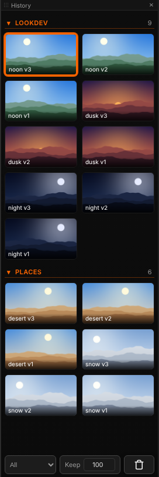

# History

[Home](../index.md)

The History panel (**ComfyUI ▸ History** in the lower bar) collects every render from every tab: 100 items by default, up to 500 (set at the bottom of the panel). It is kept across page reloads. Clicking a thumbnail shows it in the tab it was created in.

## Groups

Thumbnails are sorted into groups. The group comes from the `group` input of the Send node that produced the render, or from the agentY stage that saved it. The most recently used group is on top; inside a group the newest item comes first.

| Action | Input |
|---|---|
| Collapse a group | Click its heading |
| Reorder groups | Drag a heading up or down |
| Move thumbnails to a group | Drag them onto the heading, or right-click ▸ **Move to group** |
| Rename a group | ✎ on the heading, or right-click it; an existing name merges both groups |

## Navigation

| Action | Input |
|---|---|
| Newer / older | <kbd>↑</kbd> / <kbd>↓</kbd> |
| Multi-select | <kbd>Ctrl</kbd>+click, <kbd>Ctrl</kbd>+<kbd>Shift</kbd>+click for a range |
| Compare | <kbd>Shift</kbd>+click two items, or select several and press <kbd>C</kbd> ([Comparing](viewer.md#comparing)) |
| Remove from History | <kbd>Shift</kbd>+<kbd>Delete</kbd> or right-click ▸ **Remove**; the file on disk is kept |
| Clear | Trash button in the lower bar |

## Thumbnail actions

- **Drag onto the canvas** to create a loader node (one per selected item), or onto an existing loader to replace its file.
- **Drag into a cut, a Paint canvas, a 3D scene** or the agentY chat.
- **Right-click**: copy path, remove, move to group, **Convert Footage** for films (alpha matte, SDR to HDR, reframe, upscale), **Show dependencies** ([Dependencies](dependencies.md)), **Load workflow**, **Edit in Paint** / **Edit in Motion**, and with agentY the tags and approvals ([Working with agentY](agentY.md)).

Items whose file has been deleted are removed once the server has confirmed it twice. Duplicate renders are kept once.
