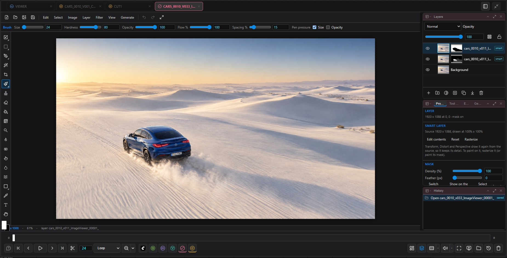

# Paint

[Home](../index.md)

A layer-based image editor: brushes, selections, masks, adjustment layers, text, filters, and generative fills that run ready-made ComfyUI workflows.

## Opening

- **Open Paint…** in the lower bar's Paint menu: the open canvas, otherwise the last image, otherwise a new 1920 × 1080 white canvas.
- Right-click a History thumbnail ▸ **Edit in Paint**, or open an `.ora` / `.psd` from the file browser.

Panels (Paint tabs only): **Layers**, **History**, and **Properties**, **Tool options**, **Effects** and **Generate** as tabs sharing one slot.

## Tools

| Key | Tool |
|---|---|
| <kbd>V</kbd> / <kbd>Shift</kbd>+<kbd>V</kbd> | Transform (<kbd>Ctrl</kbd>+<kbd>T</kbd>) / transform selection. <kbd>Enter</kbd> applies, <kbd>Esc</kbd> cancels |
| <kbd>M</kbd> <kbd>L</kbd> <kbd>W</kbd> | Rectangle / ellipse marquee, lasso, magic wand |
| <kbd>C</kbd> | Crop |
| <kbd>B</kbd> <kbd>E</kbd> | Brush (pen pressure, flow, custom tips), eraser |
| <kbd>S</kbd> | Clone stamp; <kbd>Alt</kbd>+click sets the source |
| <kbd>J</kbd> / <kbd>Shift</kbd>+<kbd>J</kbd> | Spot healing, healing brush, patch |
| <kbd>G</kbd> / <kbd>Shift</kbd>+<kbd>G</kbd> | Paint bucket / gradient |
| <kbd>O</kbd> <kbd>R</kbd> <kbd>Shift</kbd>+<kbd>R</kbd> | Dodge, burn, sponge; smudge; blur brush |
| <kbd>U</kbd> | Shapes (rectangle, rounded rectangle, ellipse, polygon, line) |
| <kbd>P</kbd> <kbd>A</kbd> | Pen and path selection tools |
| <kbd>I</kbd> <kbd>T</kbd> <kbd>H</kbd> | Eyedropper (drag to average an area), text, hand (or hold <kbd>Space</kbd>) |

<kbd>X</kbd> swaps foreground and background colour, <kbd>D</kbd> resets them. Holding <kbd>B</kbd> while dragging on the canvas sets brush size (horizontal) and opacity (vertical, <kbd>Shift</kbd>: hardness). Related tools share one toolbar slot; right-click the slot for the others.

## Layers

- Pixel, text, group and adjustment layers (Levels, Curves, Brightness/Contrast, Exposure, Hue/Saturation, Grade, Invert, Threshold), each with blend mode and opacity. Adjustment panels show a before/after histogram.
- <kbd>Shift</kbd> / <kbd>Ctrl</kbd>+click selects several layers; <kbd>Ctrl</kbd>+<kbd>G</kbd> groups, <kbd>Ctrl</kbd>+<kbd>E</kbd> merges, <kbd>Ctrl</kbd>+<kbd>J</kbd> duplicates.
- <kbd>Alt</kbd>+click a layer to clip it to the layer below; <kbd>Alt</kbd>+click an eye to solo.
- **Masks**: click the mask thumbnail to paint it, <kbd>\</kbd> shows it on the canvas. Dropping a layer onto another layer's row turns its luminance into that layer's mask. **Quick Mask** (<kbd>Q</kbd>) paints the selection.
- **Layer styles** (drop shadow, outer glow, stroke, colour overlay), **smart filters** and **smart layers** (placed images that keep their source resolution through any transform) stay editable.
- **Lock transparency** restricts painting to existing pixels.

## Selection, transform, filters

- **Select ▸** Expand, Contract, Smooth, Border, Colour range. Rulers (<kbd>Ctrl</kbd>+<kbd>R</kbd>), guides and snapping.
- **Layer ▸** Distort, Perspective, Warp. **Filter ▸ Liquify** (<kbd>Shift</kbd>+<kbd>Ctrl</kbd>+<kbd>X</kbd>).
- **Filter**: Gaussian / motion blur, sharpen, unsharp mask, high pass, median, noise, pixelate and every adjustment applied to the pixels, all with a live preview.
- <kbd>Ctrl</kbd>+<kbd>C</kbd> / <kbd>X</kbd> / <kbd>V</kbd> also exchange images with other applications through the system clipboard.

## Generate

The Generate panel and menu send the selection (plus some surrounding context) through a ComfyUI workflow and return the result as a new, masked layer in a single undo step:

| Action | Models |
|---|---|
| Generative fill, remove object, extend, edit, extend empty areas | FLUX Fill / Kontext, Qwen Image Edit, GPT Image, Nano Banana, Seedream and others, local or API |
| Remove background, select foreground | BiRefNet, Bria, Recraft, ComfyUI-RMBG models |
| Select objects | SAM 3.1, by text or inside the selection box |
| Upscale | Upscale models, SeedVR2, Magnific, Crystal, Recraft, Topaz |

Only workflows whose nodes are installed are offered. Missing model files are listed with size and target folder and only downloaded (from Hugging Face) after you confirm; the [install log](reference.md#install-log) shows the download as it runs. **Generate ▸ Workflows…**, or Settings ▸ ComfyUI Image Viewer ▸ Paint, selects the workflow per action and accepts your own API-format workflow.

## Saving

| Command | Result |
|---|---|
| Save (<kbd>Ctrl</kbd>+<kbd>S</kbd>) | An `.ora` is saved in place; an image, `.psd` or new canvas is saved as the next version |
| Save as… | Name, format (`.ora` or `.psd`) and folder |
| Export… | PNG, JPEG, WebP, TIFF or PSD; adjustment layers are baked into a PSD |

New `.ora` / `.psd` files are added to the History. agentY can edit the open image, including unsaved changes.

Paint is a clean-room implementation; see the README.
