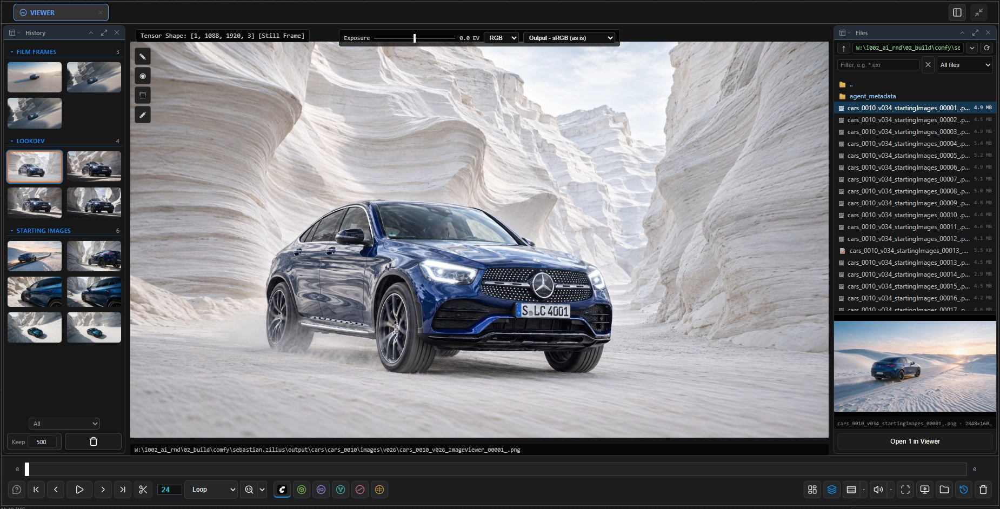
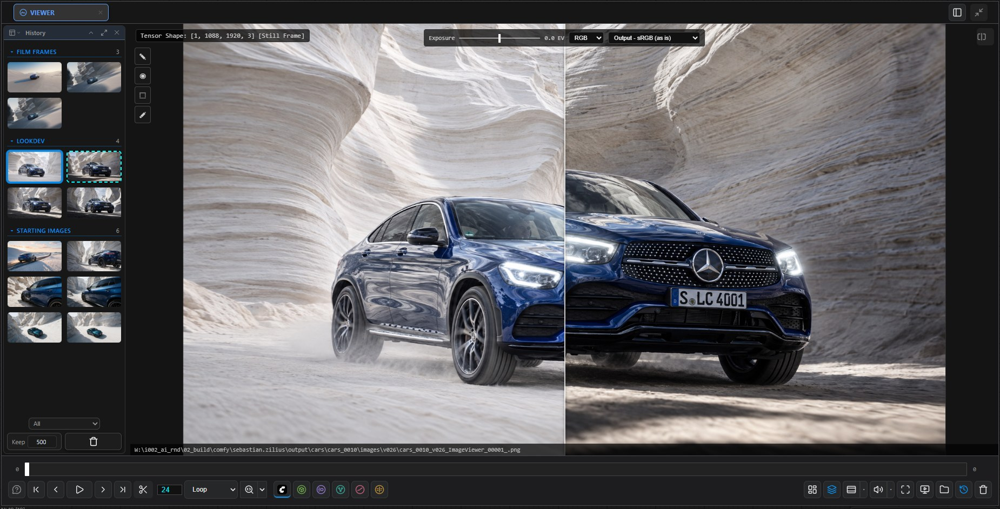
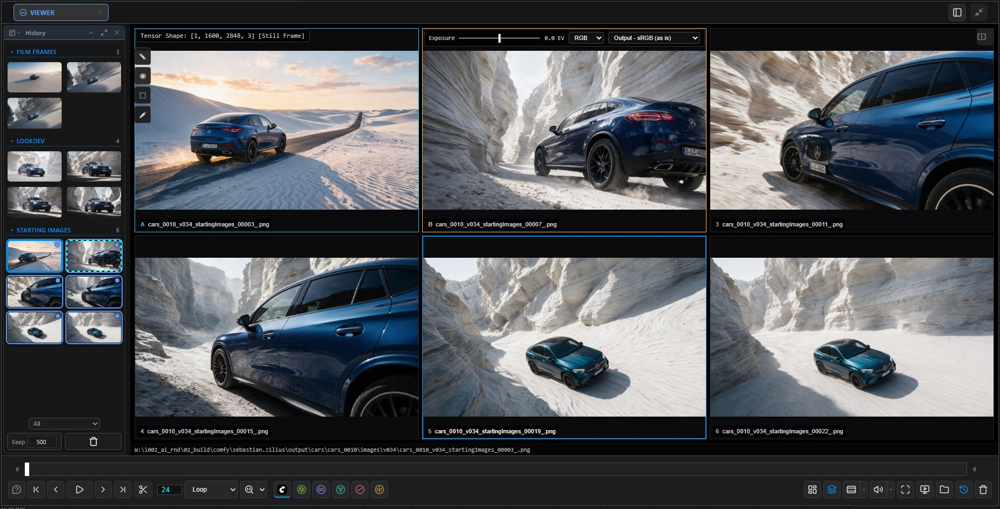

# Viewer

[Home](../index.md)

The **🖼 Viewer** tab shows pictures, image sequences, videos and sounds. Everything you only look at goes here; documents get spaces of their own.

## Getting things in

- A **Send To Image Viewer** node: its renders become a group of the [History](history.md), named by its `group` input.
- Right-click any node ▸ **Send to Image Viewer** (several selected: all of them).
- Open or drag files from the [file browser](workspace.md#file-browser), or drop them from the desktop.

A new render is put on screen only while you look at the newest one.

## Looking

| To | Do |
|---|---|
| Fit / zoom / pan | <kbd>F</kbd> / the zoom menu / drag |
| Full screen | <kbd>Shift</kbd>+<kbd>F</kbd> (<kbd>Esc</kbd> leaves) |
| Exposure | The slider at the top, or hold <kbd>E</kbd> and drag |
| One channel | <kbd>R</kbd> <kbd>G</kbd> <kbd>B</kbd> (again for RGB) |
| Input colourspace | The OpenColorIO menu at the end of the exposure bar |
| Hide overlays | <kbd>S</kbd> |
| Framing mask (16:9, 2.39 …) | <kbd>Shift</kbd>+<kbd>G</kbd>; its ▾ picks the ratio |

Exposure and channels change only what you see.

## Comparing

| To | Do |
|---|---|
| Wipe two | <kbd>Shift</kbd>+click two thumbnails or tabs, drag the divider |
| Contact sheet of up to 16 | <kbd>Ctrl</kbd>+click them in the History, then <kbd>C</kbd> |
| Change mode / stop | <kbd>C</kbd> |

Videos in a compare play in step.

## Playing

| To | Do |
|---|---|
| Play / pause | <kbd>Space</kbd> |
| Step | <kbd>←</kbd> <kbd>→</kbd> (<kbd>Ctrl</kbd>: first / last) |
| Loop part of it | <kbd>Ctrl</kbd>+drag on the timeline |
| A frame onto the graph | <kbd>Shift</kbd>+drag the timeline onto the graph |

Sounds show their waveform; click it to seek.

## Drawing tools

The toolbar at the top left of the picture: **Roto** (mattes onto a Roto node), **SAM3 points / boxes** (prompts onto a SAM3 Collector node) and **Annotate** (text, arrows, boxes, strokes, saved beside the file). Their options are in the Parameters panel. See [Nodes](nodes.md#roto-and-sam3-collector).
