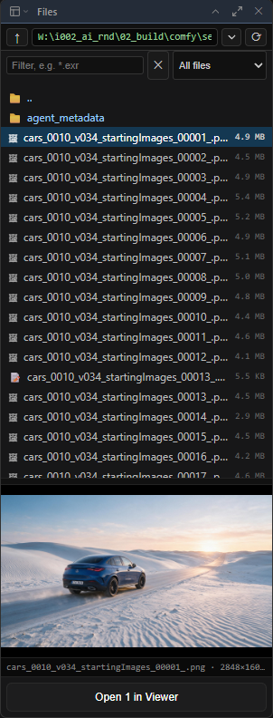

# Panels & workspace

[Home](../index.md)

## The viewer window

- **Image Viewer** in ComfyUI's top bar shows or hides the viewer.
- **Floating**: drag the tab bar to move it, the edges to resize.
- **Docked** (<kbd>Shift</kbd>+<kbd>D</kbd>): attached to the left, right or bottom of the ComfyUI page; the canvas shrinks to make room.
- **Undocked**: opens in a separate browser window or tab, e.g. for a second monitor. All hotkeys work there.

## Panels

Panels and the picture share the viewer's area, split side by side and one above the other as you like.

- Drag a panel by its title bar onto any edge of another panel, of the picture or of the whole area: that place splits in two, the panel on the side you dropped it. Drop it onto the middle of a panel to stack both as tabs.
- Drag the gap between two places to share the room differently.
- The button left of the panel name switches what that slot shows.
- The buttons next to **✕** collapse the panel to its title bar or maximise it over the viewer.
- Every space (Viewer, 3D, Comp, Edit, Paint, Motion, Farm) keeps a layout of its own: arrange the panels for 3D work once and they come back with every 3D tab. **Reset this space's panels** in the **layout** menu puts the space that is up back to how it shipped.
- **The main view is a panel too.** Its title bar names the tab it shows; the switch button at its left picks another open tab, or trades places with a panel. Drag the bar to put the picture beside a panel, above or below it, or along an edge of the whole area; drop it on the middle of a panel to swap the two. The button at its right fills the viewer with it. Each space keeps where its main view is.
- **Second view** (in the **ComfyUI** menu, or the switch button of any panel) shows another open tab next to the picture: a 3D scene, a picture or a film. A 3D scene there has a camera of its own and can look through any of the scene's cameras, so the same tab can be up in both places: the working view in the middle, the shot camera beside it. It follows the time of the main view and changes nothing in the scene.
- The **layout** menu saves the current arrangement, every space's, under a name and can set it as default.

The lower bar holds the transport and one menu per area: **ComfyUI** (History, Parameters, Agent code, Dataset, agentY, Second view), **3D**, **Motion**, **Paint**, **Comp** and **Timeline**.

## File browser

Opened with the folder button in the lower bar.

- **Filter** accepts wildcards (`*.exr`, `hero_??.png`) and persists while you change folders; **Kind** limits the list to images, video, audio, 3D and so on.
- Double-click opens a file. Rows can be dragged onto the picture, the canvas (creates a loader node), a cut or the agentY chat.
- Numbered images are folded into one sequence.

Accessible folders are ComfyUI's input, output and temp folders plus those added under **Settings ▸ ComfyUI Image Viewer ▸ Folders** (see [Reference](reference.md#folders)).

## Parameters

Shows the widgets of the node selected on the canvas; the padlock pins it to one node. While a drawing tool is active it shows the tool's options instead, on a 3D tab the Channel Box, and on a Comp tab the selected comp nodes. Each parameter row has a small padlock of its own (shown on hover): a locked parameter keeps its value. Its field and its widget on the canvas are greyed out, edits made with several nodes selected pass it by, and it cannot be keyed. The lock is saved with the workflow.

## Settings

**Settings ▸ ComfyUI Image Viewer** is one page of foldable sections: the allowed folders and the defaults for playback, compare, History, annotation, 3D and docking, each with its explanation under it. A field at the top finds a setting by name; **Show advanced settings** adds the rarely needed ones (every single colour, the docked sizes, experimental switches). A dot and ↺ beside a value mark a change from the default and put it back. Settings are stored per OS user (`~/.comfyui_image_viewer/settings.json`), so they carry over between ComfyUI installs. **Colours** offers presets (by default the viewer follows ComfyUI's palette); the individual colours are among the advanced settings. Hotkeys are under **Settings ▸ Keybinding** ([Hotkeys](hotkeys.md)).
