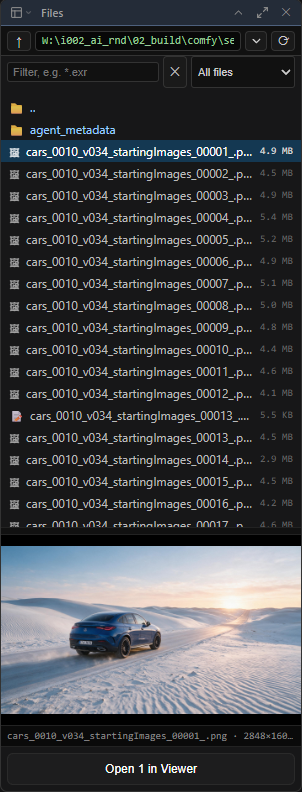

# Panels & workspace

[Home](../index.md)

## The viewer itself

- **Image Viewer** in ComfyUI's top bar shows and hides it.
- **Floating**: drag the tab bar to move it, its edges to resize.
- **Docked** (<kbd>Shift</kbd>+<kbd>D</kbd>): a panel beside the canvas, left, right or bottom.
- **Undocked**: its own browser window (or tab), for a second screen.

## Panels

Panels sit in rails left, right and along the bottom.

- Drag a title bar onto an edge, above or below another panel, or onto its middle to share its place as a tab.
- The button left of a panel's name switches what that place shows.
- The buttons by **✕** fold a panel and let it fill the viewer.
- The **layout** menu saves the arrangement under a name.

The lower bar holds playback, then the menus **ComfyUI** (History, Parameters, Agent code, Dataset, agentY), **3D**, **Motion**, **Paint**, **Comp** and **Timeline**.

## File browser

The folder button in the lower bar.

- **Filter** takes wildcards (`*.exr`); **Kind** narrows to images, video, audio, 3D …
- Double-click to open; drag rows onto the picture, the graph (a loader node), a cut or the agentY chat.
- A folder of images opens as one sequence.

It opens ComfyUI's input, output and temp folders and the ones added in **Settings ▸ ComfyUI Image Viewer ▸ Folders** (see [Reference](reference.md#folders)).

## Parameters

The widgets of the node selected on the graph (the padlock keeps it on one node). While a drawing tool is on, the tool's options; on a 3D tab, the Channel Box; on a Comp tab, the selected comp nodes.

## Settings

**Settings ▸ ComfyUI Image Viewer** holds the allowed folders and the defaults for playback, compare, History, annotation, 3D and docking, kept per OS user. **Colours** has presets (Follow ComfyUI by default, Paint, Classic …) and every colour of the viewer. Keys are in **Settings ▸ Keybinding** (see [Hotkeys](hotkeys.md)).
