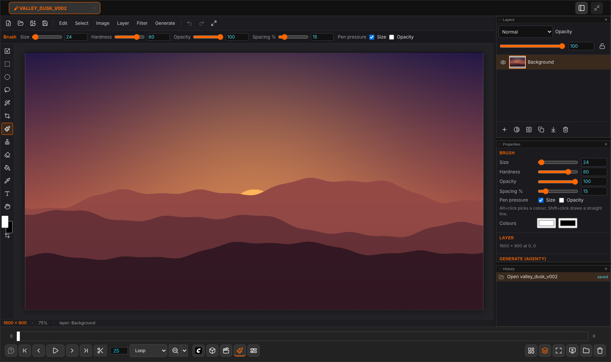

# Paint

[Home](index.md)

A small picture editor: layers, brushes, selections, masks, adjustment layers, text, and AI fills through agentY.

## Opening a picture

- **Open Paint…** in the lower bar's Paint menu: the open canvas, else the last picture, else a new white 1920 × 1080 canvas.
- Right-click a History thumbnail ▸ **Edit in Paint**.
- Open an `.ora` or `.psd` from the file browser.

Its panels show only on a Paint tab: **Layers**, **History** and, sharing one place as tabs, **Properties** (the active layer, its mask, and Fill while it is open), **Tool options** (the current tool's controls and the two colours), **Effects** (the active layer's style and smart filters) and **Generate** (the prompt, the generate buttons, variations, Workflows…). Click a tab's name to bring it up, or drag a tab out to give it a place of its own; Paint's group in the bottom bar opens and closes each one. Layer style… and Smart filters… bring Effects to the front, Fill (Shift+F5) Properties. The row under the menus holds the current tool's options as well.

## Tools

| Key | Tool |
|---|---|
| <kbd>V</kbd> | Transform: move, scale, rotate, shear (<kbd>Ctrl</kbd>+<kbd>T</kbd>). <kbd>Enter</kbd> applies, <kbd>Esc</kbd> cancels |
| <kbd>Shift</kbd>+<kbd>V</kbd> | Transform selection (under the Transform tool: right-click it): the selected pixels of the active layer are lifted off it and moved, scaled, rotated or sheared like a layer; the place they came from is left empty. <kbd>Enter</kbd> puts them down into the layer, the selection moved with them (one undo step); <kbd>Esc</kbd> puts everything back |
| <kbd>M</kbd> / <kbd>Shift</kbd>+<kbd>M</kbd> | Rectangle / ellipse select |
| <kbd>L</kbd> | Lasso |
| <kbd>P</kbd> / <kbd>Shift</kbd>+<kbd>P</kbd> | Pen: Bezier paths (see below) / add anchor, delete anchor, convert point |
| <kbd>A</kbd> / <kbd>Shift</kbd>+<kbd>A</kbd> | Path selection / direct selection |
| <kbd>W</kbd> | Magic wand |
| <kbd>C</kbd> | Crop |
| <kbd>B</kbd> | Brush (reads pen pressure). **Flow** (brush and eraser) is how much each dab lays: going over a place again in the same stroke builds it up, as with a paintbrush, but never past **Opacity** |
| <kbd>S</kbd> | Clone stamp: <kbd>Alt</kbd>+click sets the source. Show overlay previews the source inside the brush. The source can be turned, scaled and flipped |
| <kbd>J</kbd> | Spot healing brush: paint over a blemish and it is filled from a nearby place that looks alike |
| <kbd>Shift</kbd>+<kbd>J</kbd> | Switches between the healing brush, the patch and the spot healing brush. The **healing brush** paints the texture from a source (<kbd>Alt</kbd>+click) in the light and colour of where it lands. The **patch** fills a selection from wherever you drag it, or carries it there (Destination) |
| <kbd>E</kbd> | Eraser |
| <kbd>G</kbd> | Paint bucket |
| <kbd>Shift</kbd>+<kbd>G</kbd> | Gradient (see below) |
| <kbd>O</kbd> / <kbd>Shift</kbd>+<kbd>O</kbd> | Dodge (lightens), then burn (darkens) and the sponge (takes colour out or puts more in). Dodge and burn work most on the shadows, the midtones or the highlights; Exposure sets how strongly |
| <kbd>R</kbd> | Smudge: drags the paint along the stroke. Strength sets how far; Finger painting starts each stroke with the colour |
| <kbd>U</kbd> / <kbd>Shift</kbd>+<kbd>U</kbd> | Shapes: rectangle, rounded rectangle, ellipse, polygon, line (Shift+U: the next one) |
| <kbd>I</kbd> | Eyedropper: a click takes the colour under the pointer; dragged, it draws a box and takes the average colour inside it |
| <kbd>T</kbd> | Text |
| <kbd>H</kbd> or hold <kbd>Space</kbd> | Hand |

<kbd>X</kbd> swaps the two colours, <kbd>D</kbd> resets them.

Tools of one kind share one place in the toolbar: Transform and Transform selection, the selections (rectangle, ellipse, lasso), the brush with the healing tools (spot healing brush, healing brush, patch), the path tools, and the shapes (rectangle, rounded rectangle, ellipse, polygon, line). The place shows the tool used last. Right-click it for the others.

On a big picture (more than about two million pixels) seen smaller than half its size, moving or transforming a layer, dragging a gradient and pulling a slider show a quick preview at about the screen's resolution while you drag. The full picture is drawn as soon as you let go, or when a slider stays still for a moment.

## Brush tips

The brush and the eraser can paint with a picture as their tip instead of a round dab. The tips are in Tool options. Paint comes with 14 tips of its own (rough round, chalk, charcoal, sponge, splatter, spray, flat bristle, hatching, grass, leaves, star, square, clouds, canvas grain). They are drawn by the viewer when Paint starts, so they carry no other licence. They cannot be deleted.
- **Import .abr…** (also **Brush > Brush tips / Import .abr…**) opens the Brush tips dialog. **Choose .abr files…** or drop .abr files on it; it says what each file brought. The dialog also lists the built-in tips and yours; a click chooses one, × forgets one of yours. Only the sampled tips of a brush file are read, which are the ones drawn from a picture. Computed round brushes and the brush settings saved with them (dynamics, textures) are not read; the note after the import says what was left out. The file is read in the browser and is not sent to the server.
- **From selection** makes a tip from the selected part of the picture as it looks. Dark parts paint, light parts do not. **Edit > Define brush tip from the selection** does the same.
- **Invert** paints with the light parts instead. **Delete** removes the tip.

The tips are kept in this browser (IndexedDB), not in the picture. The tip's longer side is the brush size. With a tip chosen, **Angle** turns it, and **Direction: follow the stroke** makes the tip point the way the stroke is going while you paint (Angle then turns it further from that way; a click without a move keeps the tip as it is). **Scatter**, **Size jitter** and **Angle jitter** vary each dab.

The .abr reader was written from the file's published layout and tested on files built for the tests. Brush files from other programs may still hold a variant it cannot read; it then says so and reads nothing.

## Gradient and shapes

**Gradient**: drag across the picture. <kbd>Shift</kbd> keeps the line in 45° steps. The types are Linear, Radial, Angle, Reflected and Diamond. The colours are the colour to the second colour, the colour to transparent, colour / second / colour, or black to white; Reverse turns them round. The gradient goes into the selection on the layer. With the mask picked it goes into the mask, as grey.

**Shapes**: drag a box. <kbd>Shift</kbd> makes it square or round, <kbd>Alt</kbd> draws it from the middle. A shape goes onto a new layer of its own, filled with the colour, with an edge in the second colour if Edge is on. A line is drawn in the colour. With Make: A path, the shape becomes a pen path instead, to select, fill, stroke or make a mask from later.

The agent has both as ops: `gradient` (`from`, `to`, `type`, `colors` or `stops`, `opacity`, `reverse`; inside the selection when there is one) and `shape` (`kind`, `box` [x, y, w, h] or `from` / `to` for a line, `fill`, `stroke`, `width`, `radius`, `sides`, `as_path`).

## Distort, Perspective and Warp

**Layer** menu, or the buttons in the Transform tool's options:
- **Distort**: drag each corner of the layer anywhere.
- **Perspective**: drag a corner, and the corner at the other end of the same edge moves the opposite way, so the edge stays centred.
- **Warp**: bends the layer with a grid of points (1 x 1 up to 8 x 8). The picture follows a smooth surface that passes through every point.

The layer's mask goes with it. Press <kbd>Enter</kbd> or double-click to apply, as one undo step. <kbd>Esc</kbd> cancels. The agent can distort a layer with the `distort` op, which takes four `corners`.

## Liquify

**Filter > Liquify** (<kbd>Shift</kbd>+<kbd>Ctrl</kbd>+<kbd>X</kbd>) is a brush that pushes the active layer's pixels about. Its modes are **Forward warp** (drags the picture along the stroke), **Reconstruct** (brushes it back to how it was), **Twirl** clockwise or anticlockwise, **Pucker** (pulls in toward the middle of the brush) and **Bloat** (pushes out). Size (<kbd>[</kbd> / <kbd>]</kbd>) and strength are in the tool's options, along with **Restore all**. Nothing is kept until you press <kbd>Enter</kbd>, which applies everything as one undo step. <kbd>Esc</kbd> throws it away. A layer smaller than the canvas is grown to the canvas first, so pixels can be pushed into the space around it.

## Smart filters

A smart filter is kept as a setting on the layer instead of being baked into its pixels, so you can change it, switch it off, reorder it or take it away later. Add one from the **Filter** menu ("Smart filter: Gaussian blur", "Sharpen", or "an adjustment…" such as Levels or Hue/Saturation), or with **Add…** in the Effects panel. Each filter there has its switch, ▲ ▼ to change the order, × to remove it, and its numbers. A layer with smart filters shows "sf" in the Layers panel. **Bake into the pixels** (or **Layer > Bake smart filters**) applies them for good. A blur reaches past the layer's own box, as it would on a layer the size of the canvas. A `.ora` keeps them; a `.psd` gets them baked in. The agent sets them with `set_layer` `filters`: a list of `{type, params, on}` in order, or null to take them off.

## Smart layers

A smart layer keeps the picture it was made from at its full size, and remembers how it is placed (moved, scaled, turned, sheared, in perspective) as a setting. Each time you transform it, it is drawn again from that original, so you can shrink it to a thumbnail and make it big again without losing any detail. A picture you add (Layer > Add picture as layer…, or the agent's `add_layer` with a file) comes in as a smart layer. **Layer > Convert to smart layer** turns any pixel layer into one. The Layers panel marks it "smart", and Properties shows its source size and three buttons: **Edit contents**, **Reset** (back to the source's own size, still in the same place) and **Rasterize**.

- **Edit contents** opens the original in a Paint tab of its own. Change it there and save, and every layer made from it is drawn again from what you saved, in the same place, as one undo step.
- Painting, filters, liquify and warp need pixels, so they are refused on a smart layer: rasterize it first (Layer > Rasterize). Its mask can still be painted. Move, Free transform, Distort, Perspective, flip, rotate and Image size all redraw it from the source.
- When the agent changes a smart layer's pixels (a fill, a filter), the layer becomes an ordinary one and the answer says so. The agent can also use the `rasterize` op, and `add_layer` with `"smart": false` for a plain layer.
- A `.ora` keeps the original beside the layer (`smart/<id>.png`). A `.psd` gets the pixels as they are drawn, with a note.
- A picture can be up to 16384 pixels on a side. A layer blown up far past the canvas is drawn only where the canvas is.

## The pen

<kbd>P</kbd> draws a path one anchor at a time. Click for a corner and drag for a smooth anchor (Shift holds the handle to 45° steps). Click the first anchor to close the path, or press <kbd>Enter</kbd> or <kbd>Esc</kbd> to leave it open. Click the path to add an anchor, or click an anchor to take it away. Click an end of an open path to carry on drawing from it.

<kbd>Ctrl</kbd>+drag moves an anchor or a handle. <kbd>Alt</kbd>+click turns an anchor into a corner, or a corner into a smooth anchor as you drag. <kbd>Alt</kbd>+drag a handle to move it on its own. <kbd>Del</kbd> deletes the picked anchor, or the whole path when no anchor is picked.

**The path tools.** Right-click the pen's button for the tools that change paths; the button then shows the one you picked. With any of them, every path on the picture is drawn, so you can click one to work on it.

| Tool | What it does |
|---|---|
| Add anchor point | Click a path's curve to put an anchor there; drag to move it on. |
| Delete anchor point | Click an anchor to take it away. |
| Convert point | Click a smooth anchor to make it a corner; drag from a corner to make it smooth. Drag a handle to move it alone. |
| Path selection (<kbd>A</kbd>) | Click a path to pick it and drag to move the whole path. <kbd>Alt</kbd>+drag moves a copy. The arrows nudge it (<kbd>Shift</kbd>: 10 px) and <kbd>Del</kbd> deletes it. |
| Direct selection (<kbd>Shift</kbd>+<kbd>A</kbd>) | Click an anchor to pick it, <kbd>Shift</kbd>+click to pick more, or drag a box around anchors. Drag to move the picked anchors together, or drag a handle. A drag on the curve moves the anchors at its two ends. The arrows nudge them, <kbd>Del</kbd> takes them away, and <kbd>Esc</kbd> lets go. <kbd>Shift</kbd> while dragging keeps the move straight. |

<kbd>Ctrl</kbd>+<kbd>Enter</kbd> makes the inside of the path the selection (<kbd>Shift</kbd> adds to it, <kbd>Alt</kbd> takes away). Tool options picks and renames paths and has **Selection** (with how it combines and a feather), **Fill** and **Stroke** (in the colour, on the layer or on its mask while that is picked), and **Mask** (the active layer's mask from the path). Paths are saved in the `.ora`, but not in a `.psd`. A crop or resize moves them with the picture.

## Layers

- **Pick several**: <kbd>Shift</kbd>+click picks every row between, <kbd>Ctrl</kbd>+click adds or takes away one, <kbd>Ctrl</kbd>+<kbd>Alt</kbd>+<kbd>A</kbd> picks them all. Opacity, blend mode, lock, the eye, delete, duplicate, drag and the Move tool then work on all of them. <kbd>Ctrl</kbd>+<kbd>E</kbd> merges them into one.
- **Groups**: <kbd>Ctrl</kbd>+<kbd>G</kbd> puts the picked layers into a group, <kbd>Ctrl</kbd>+<kbd>Shift</kbd>+<kbd>G</kbd> takes them out again, and the folder button makes an empty one. The arrow folds a group. Drag a layer onto the middle of a group's row to put it inside. A group has its own opacity, mask and blend mode. **Pass Through** lets its layers mix with what is under the group as if they weren't grouped. Any other mode lays the group's layers together first, so an adjustment layer inside only changes the group. <kbd>Ctrl</kbd>+<kbd>E</kbd> on a group merges it into one layer. Groups are saved in `.ora` and `.psd` files and read back from them.
- **Clipping masks**: <kbd>Alt</kbd>+click a layer (or <kbd>Ctrl</kbd>+<kbd>Alt</kbd>+<kbd>G</kbd>) to clip it to the layer under it, so it only shows where that layer is. Do the same again to release it. Clip an adjustment layer like this and it changes only that one layer. A clipped row is indented with an arrow, and the name of the layer it is clipped to is underlined.
- Pixel, text and **adjustment** layers (Levels, Curves, Brightness/Contrast, Exposure, Hue/Saturation, Grade, Invert, Threshold), with blend modes and opacity. Their panel shows a **histogram** of the picture going in, with what comes out drawn over it in orange:
  - **Levels**: drag the black, grey and white handles under the histogram, and the output black and white under the grey bar, or type the numbers. RGB, Red, Green or Blue: a channel's levels come after the RGB ones. **Auto** clips 0.1 % at each end (on RGB, each channel on its own). **Reset**.
  - **Curves**: on top of the histogram, with the other channels' curves faint. Click to add a point and drag it. Drag a point off the graph (or press Del) to remove it, and use the arrows to nudge it. A picked point's input and output are shown as numbers. There are also **presets** (contrast, lighter, darker, negative, faded).
  - **Threshold**: click or drag on the histogram to set the level.
  - **Hue/Saturation** shows the colours before and after as two bars, and **Grade** has a slider for each channel. The sliders' tracks show what they do.
- **Masks**: white shows, black hides. Click the mask's thumbnail to paint on it; while the mask is picked, Fill, Delete and the bucket work on the mask too. <kbd>Alt</kbd>+click the mask's thumbnail to see the mask alone (<kbd>Esc</kbd> or another <kbd>Alt</kbd>+click goes back), <kbd>Shift</kbd>+click switches it off and on. <kbd>Ctrl</kbd>+click a thumbnail makes a selection from the layer's pixels or from its mask (with <kbd>Shift</kbd> it adds, with <kbd>Alt</kbd> it takes away). Properties has the mask's **Density** (how much the black hides) and **Feather** (a soft edge), which change nothing in the mask's pixels; a `.psd` gets them baked in.
- **Layer styles** (**Layer > Layer style…**, or the "fx" mark on a layer's row): a **drop shadow** (angle, distance, blur), an **outer glow**, a **stroke** round the layer's edge, and a **colour overlay**, each with its colour and opacity. They are settings, not pixels, so they follow what you paint and can be changed or switched off at any time. A `.ora` keeps them; a `.psd` gets them baked into the layer. A layer clipped to another shows without its own style.
- **Lock transparency** (the checkered button over the list, or the Layer menu): the brush and the other tools then paint only where the layer already has something, and its see-through parts stay see-through. The eraser and Delete paint the second colour instead.
- **Quick Mask** (<kbd>Q</kbd>, or the button under the tools): the selection is shown as a red tint and painted with the brush, eraser, bucket or Fill. Black takes away, white adds. <kbd>Q</kbd> again turns it back into a selection.
- **Solo**: <kbd>Alt</kbd>+click a layer's eye (or **Solo** in the layer's menu) to see only that layer (with the picked ones, when it is one of them). The eye turns orange. <kbd>Alt</kbd>+click it again, or **End solo**, and every layer is shown or hidden as it was before.
- **Drag onto the buttons**: drag layers onto the duplicate button under the list to copy them (the whole layer, even with a selection), or onto the bin to delete them.
- Double-click a name to rename. **Layer** menu: duplicate (<kbd>Ctrl</kbd>+<kbd>J</kbd>), merge down (<kbd>Ctrl</kbd>+<kbd>E</kbd>), flip, rotate, scale, lock.
- The **History** panel lists every step; click one to go back to it.

## Selections, guides and snapping

- **Select > Expand / Contract / Smooth / Border…** grow the selection, shrink it, round off its corners and specks, or turn it into a band along its edge. Each is one undo step.
- **Select > Colour range…** selects the colours near the brush colour (pick it first with the eyedropper, <kbd>I</kbd>). **Fuzziness** sets how far it reaches. It works from the picture or the active layer, and can replace, add to, take from or intersect the selection. It previews while the dialog is up.
- **View > Rulers** (<kbd>Ctrl</kbd>+<kbd>R</kbd>): drag out of a ruler to make a guide. Drag a guide with the Move tool (<kbd>V</kbd>) to move it, or drag it off the canvas to delete it. **View > New guide…** places one by number, and **Clear guides** removes them all. <kbd>Ctrl</kbd>+<kbd>;</kbd> hides and shows the guides.
- **Snapping** (on by default, <kbd>Ctrl</kbd>+<kbd>Shift</kbd>+<kbd>;</kbd> turns it off and on) pulls things onto the guides, the canvas's edges and middle, and the other layers' edges. It applies to the rectangle and ellipse selections, moving layers, the free transform's move, gradients, shapes and guides.
- A `.ora` keeps the guides (a `.psd` does not). Crop, canvas size and image size move them with the picture.

## Copy and paste

<kbd>Ctrl</kbd>+<kbd>C</kbd> copies the selection of the active layer (all of it with nothing selected), <kbd>Ctrl</kbd>+<kbd>Shift</kbd>+<kbd>C</kbd> the picture as it looks (merged), and <kbd>Ctrl</kbd>+<kbd>X</kbd> cuts. <kbd>Ctrl</kbd>+<kbd>V</kbd> pastes as a new layer in the middle of the view, and <kbd>Ctrl</kbd>+<kbd>Shift</kbd>+<kbd>V</kbd> pastes it where it was copied from. A picture copied in another program (a screenshot, an image from a browser) is pasted the same way. What you copy here is also put on the system clipboard, where the browser allows it.

## Filters

Each adjustment is also in the Filter menu "into the pixels", in a dialog with the same panel and a live preview. Every filter dialog has **Before** (hold it to see the picture without the filter) and **Reset**. A smart filter that is an adjustment (Curves too now) gets the same panel in Effects.

The **Filter** menu works on every picked pixel layer, and only inside the selection when there is one: Gaussian blur, Motion blur, Sharpen, Unsharp Mask, High Pass, Median (despeckle), Add Noise, Pixelate, and the adjustments baked into the pixels. Each number has a slider beside it, and the picture previews the result live while you drag it or type. **Cancel** undoes the preview, and **OK** keeps it as one undo step.

## Generate

The **Generate** menu and the **Generate** panel. **Fill from the surroundings**, a plain **Extend the canvas** and a plain **Upscale** work right here. **Generative fill**, **Remove object**, **Edit** (with the prompt, in the selection or on the whole picture), **Remove background**, **Select subject**, and Extend / Upscale with a workflow each run a ready-made ComfyUI workflow:

- the part around the selection is cut out (with some room around it), scaled to the size the model works at, and queued in ComfyUI with a new seed each time;
- the result comes back as a **new layer** at that place, masked to the selection, as one undo step (Remove background gives the layer a mask, Select subject makes the selection);
- **Variations** (1 to 4) makes that many layers;
- if a model the workflow needs is not on the machine, it says which and runs nothing. A model is found by its file name in any of ComfyUI's model folders and their subfolders, extra model paths included (`flux/flux1-fill-dev.safetensors` counts);
- the button you pressed shows a spinner while it runs, and a bar above the status line says what is happening: getting the picture ready, waiting in ComfyUI's queue, which node runs and how far a sampler is, laying in the result, and then **Done** or what went wrong. **Stop** on the bar takes the run out of the queue, or interrupts it.

| Action | Comes with |
|---|---|
| Generative fill, Remove object, Extend | FLUX.1 Fill dev (also GPT Image 2 and 2.5 inpaint; OneReward removal for Remove) |
| Edit | FLUX.1 Kontext (also Qwen Image Edit 2511 local, plain or 4-step Lightning; and through the API: Qwen Image 3, GPT Image 2.5, Seedream 5.0 Pro, Nano Banana 2, Nano Banana Pro, Nano Banana 2.1) |
| Remove background, Select subject | RMBG 2.0 |
| Upscale | an upscale model (also Magnific) |

**Generate › Workflows…** picks which one each action runs. **Settings › ComfyUI Image Viewer › Paint › Generate workflows** does the same and lets you put **your own** in place of one: **Use the canvas** takes the workflow on the canvas now, **Load API file…** a workflow saved with *Export (API)*. Name its nodes `paint:image` (Load Image), `paint:mask` (Load Image (as Mask), optional), `paint:prompt` (where the words go) and `paint:output` (Save or Preview Image); without those names the first Load Image, the positive prompt and the last Save Image are used. Your workflows are kept on the ComfyUI machine in `~/.comfyui_image_viewer/paint_workflows/`. The choice **agentY builds one** asks agentY instead, as before.

## Saving

| | |
|---|---|
| **Save** (<kbd>Ctrl</kbd>+<kbd>S</kbd>) | An `.ora` is saved over itself. A picture, a `.psd` or a new canvas is saved as the next version, never over the original |
| **Save as…** | A name, a format (`.ora` with everything, or `.psd`) and a folder, typed or picked with **Browse…**. It asks before writing over a file. The tab then works on the new file |
| **Export…** | PNG, JPEG, WebP, TIFF or PSD. Adjustment layers are baked into a PSD |

A new `.ora` or `.psd` (Save as, a new version, an export) also goes into the **History**, shown as a picture of how it looks; **Edit in Paint** on it opens the file itself. `.ora` (OpenRaster) opens in Krita and GIMP too. agentY can edit the open picture as well. It works on the picture as you see it, unsaved changes included, saves it (a new canvas or a plain picture as a new `.ora` version), and its change comes in as one undo step. A picture it generates for the picture comes back as a new layer at the canvas's size.
