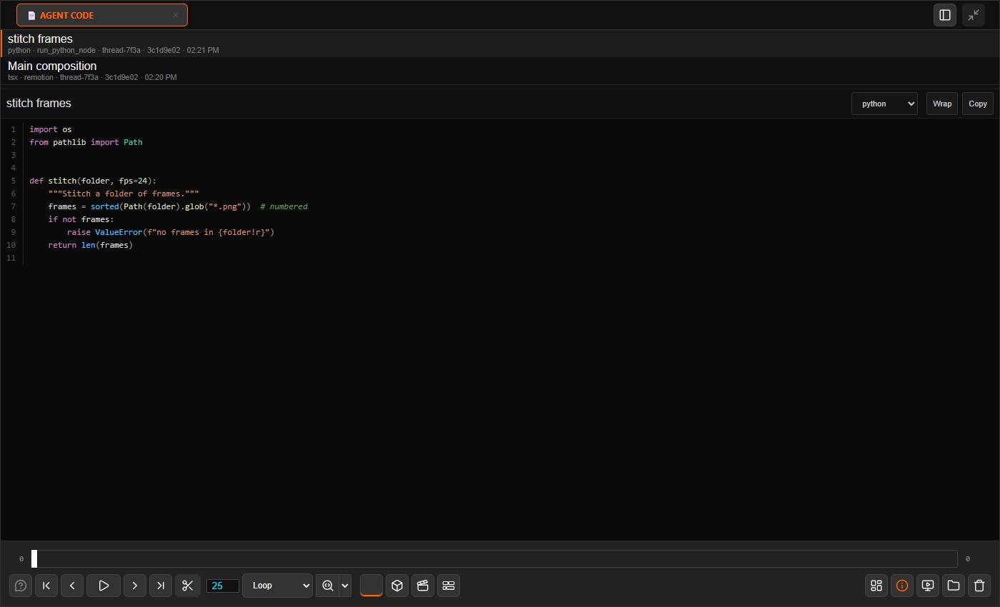

# Agent code tab

The "Agent code" reader is a tab of the main canvas (bar: ComfyUI > Agent code; no dock panel). It shows the code agentY makes, read-only, with
Python/JS/TS/JSON/shell/Markdown highlighting, line numbers, a Copy button and a Wrap switch. The list on
top is newest first: title, language, source (the tool), conversation, turn, time. A dot on the ComfyUI
bar button says new code arrived while the feed tab was not in front.

Where it comes from (agentY side, `src/utils/code_sink.py`): `run_script` and `run_python_node` code, files
written with a code extension (custom nodes included), source-code arguments of MCP tools (Remotion
compositions), and fenced blocks in the agent's reply. Identical snippets are kept once.

Text files: double-click a text/code file in the file browser (kind "Text & code") and it opens in a tab of its own
(`code:<path>`; several can be open at once, one click only previews). The bar's entry opens the feed tab (`code:`):
the list of snippets with the one shown, which follows new code while the tab is in front.

Routes: `POST /bepic/code` (a snippet in; pushed live as `bepic.code.update`), `GET /bepic/code` (recent
snippets, so a freshly opened viewer has the history), `GET /bepic/text?path=` (a file from an allowed
folder). Snippets are kept in memory per ComfyUI session. To add "edit and send back" later, call
`viewer.codePanelAddAction({label, run(snippet)})`.
