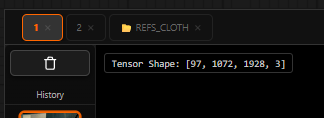
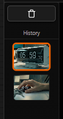
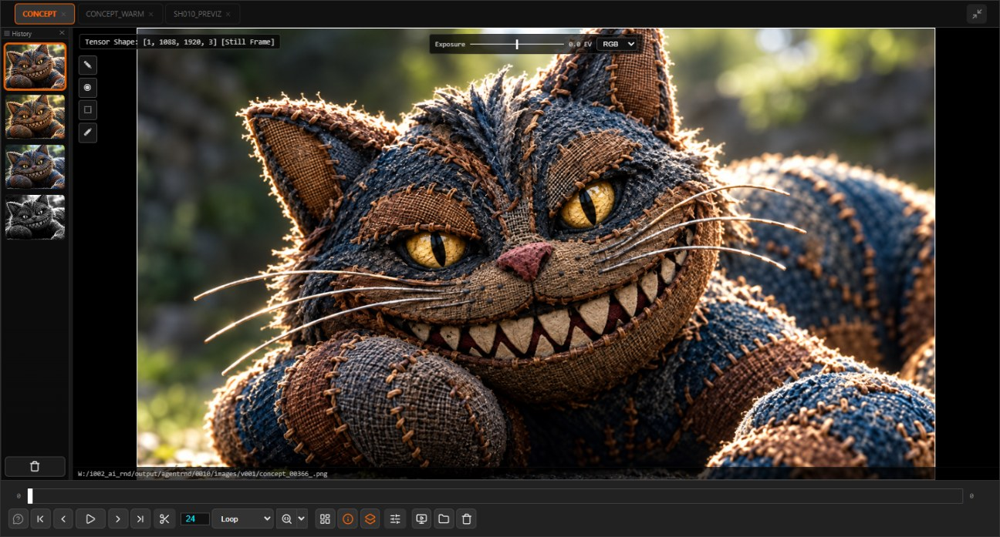
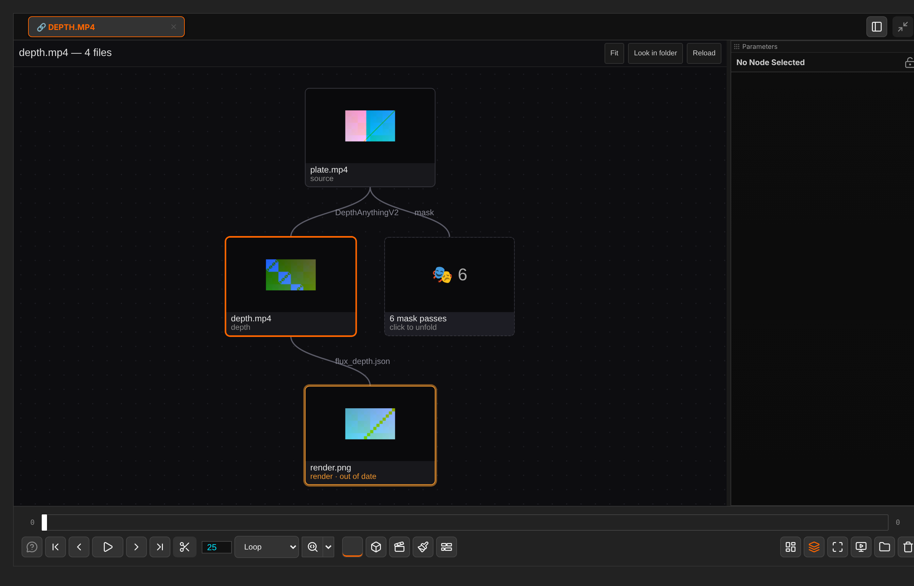
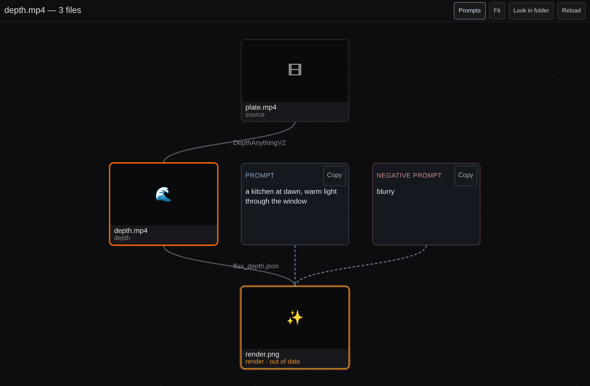

# Tabs & History

← [Back to index](../index.md)

---

## The Tab System

> [!NOTE]
> History thumbnails size themselves to the panel. Widen the rail and they grow with it; widen it far enough and they wrap into a grid of two, three or more across rather than becoming one enormous column. Drag the panel by its title bar to put it wherever suits — see [Docking Panels](interface.md#docking-panels).

Pictures, videos, sounds and meshes that you only look at share **one tab, 🖼 Viewer**. Everything sent to the viewer goes there:

- A **Send To Image Viewer** node runs — its pictures go into a **group** of the Viewer tab, named by the node's `group` input (empty: named after the node that feeds it). Roto and SAM3 nodes work the same way.
- You open files from the **File Browser** panel, or drag them onto the viewport from it — a folder's images as one sequence, each video on its own. See [File Browser](other.md#file-browser).
- You right-click a node on the canvas and choose **Send to Image Viewer** — a loader opens its file directly, any other image-producing node runs its branch first. With several nodes selected it reads **Send N to Image Viewer** and sends them all. See [Send to Image Viewer](other.md#send-to-image-viewer).
- You drop files onto the viewer, or export one.

A new render is put on screen only while you are looking at the newest one in the Viewer tab. Looking at an older snapshot or at another tab, it waits in the History.

Documents keep tabs of their own: a cut (Edit), a Paint canvas, a 3D scene, a Motion scene, a code file, a dataset and the [Dependencies](#dependencies) view. The lower bar's 3D, Motion, Paint and Timeline menus start with **Open 3D… / Open Motion… / Open Paint… / Open Edit…**: the tab of that kind that is open, else the last file opened or saved there, else an empty one.

### Naming Groups

Give each Send To Image Viewer node a meaningful `group` — for example `vae_decode`, `upscaled`, `mask`. It becomes a heading in the History strip. The optional `label` is shown on the thumbnail (a character's name, say). Workflows saved with the old `tab_name` field still load: its value is taken as the group.

### Tab Operations

| Action | How |
|---|---|
| Switch tab | Click the tab, or press <kbd>1</kbd>–<kbd>9</kbd> |
| Reorder tabs | Drag a tab left/right along the tab bar |
| Close tab | Click the **×** on the tab |
| Select for comparison | <kbd>Shift</kbd>+click (see [Image Comparison](comparison.md)) |

---

## History Snapshots

Every time new images arrive, they are saved as a snapshot in the **History**. There is one History for all tabs: a click on a snapshot shows it in the tab it was made in, switching there (or in the Viewer tab when that tab was closed). The history strip is the vertical thumbnail column on the left side of the viewport.

### Groups

The strip is drawn by group, the group used last first, newest first inside each. A heading shows the group's name and how many snapshots it holds.

| Action | How |
|---|---|
| Fold a group away / show it again | Click its heading |
| Move snapshots to another group | Drag them onto that group's heading, or right-click ▸ **📁 Move to group ▸** (an existing group, a new one, or none) |
| Rename a group | Click the ✎ on its heading, or right-click the heading. Enter renames, Esc does not; a name that already exists merges the two |

### Navigating History

With the viewer hovered, press <kbd>↑</kbd> and <kbd>↓</kbd> to move through snapshots. The most-recent snapshot is at the top. Alternatively, click any thumbnail to jump directly to it.

### Snapshot Limit

The History keeps **100 snapshots** by default (all tabs together; set another number, up to 500, at the foot of the history panel). Once the limit is reached, the oldest snapshot is removed when a new one arrives. The history is persisted to `localStorage`, so it survives page reloads, and long sequences are stored compactly so they don't fill it up.

### Selecting Several Snapshots

| Action | How |
|---|---|
| Add a snapshot to the selection | <kbd>Ctrl</kbd>+click (<kbd>Cmd</kbd> on Mac) |
| Select a range | <kbd>Ctrl</kbd>+<kbd>Shift</kbd>+click |
| Clear the selection | Click any thumbnail normally |

Selected thumbnails carry a blue ring and a dot in the corner. The selection is not persisted — it is dropped whenever the strip shifts underneath it, such as when a new snapshot arrives from a prune.

<kbd>Ctrl</kbd> rather than plain <kbd>Shift</kbd>, because <kbd>Shift</kbd>+click is [snapshot comparison](comparison.md) and that is the more valuable gesture. A snapshot can be in the selection *and* pinned for comparison at the same time.

Once several are selected:

- **Drag any one of them** onto the node graph and the whole selection is dropped, one loader node per snapshot, cascaded so none lands hidden behind another. Dragging a thumbnail that is *not* in the selection drags just that one and leaves the selection alone.
- **Press <kbd>Shift</kbd>+<kbd>Delete</kbd>** (with the viewer hovered) or use the context menu to remove them all in one go.
- **Press <kbd>C</kbd> to compare them.** Two compare as an A/B pair; three or more open on the **Contact Sheet**, a grid of all of them, videos playing in step (see [Image Comparison](comparison.md#compare-three-or-more-snapshots-contact-sheet-grid)).
- **Ask agentY about them.** With agentY installed, the agent sees what you picked in the open tab: the Ctrl-selected snapshots, the two pinned in a comparison, or the one older snapshot you clicked open. Write "use the selected ones as references" and it knows which files you mean. A strip you have not touched (only the newest render highlighted) and a closed viewer report nothing.

### Deleting Snapshots

With the viewer hovered and the history strip open, <kbd>Shift</kbd>+<kbd>Delete</kbd> removes the selected snapshots — or, when nothing is selected, the snapshot currently open in the viewer. Nothing on disk is touched. When there is nothing to delete the key is left alone.

A plain <kbd>Delete</kbd> is not used, so it always reaches ComfyUI's own delete-selected-nodes. The default binding only fires while the viewer is hovered. To change it, or to make it work with the cursor elsewhere, assign your own combo in **Settings → Keybinding** (*ComfyUI Image Viewer: Delete Selected History Snapshots*).

### History Context Menu

Right-click any thumbnail to open the context menu:

| Menu Item | Effect |
|---|---|
| 📁 Move to group ▸ | Moves it (or the selection) into another group, a new one, or out of its group |
| 🔗 Show dependencies | Opens the [Dependencies](#dependencies) tab on that file (needs agentY) |
| Copy Image Path | Copies the absolute file path of that snapshot to the clipboard — paste it into a file manager, or into the [File Browser](other.md#file-browser)'s path field to go there |
| Remove from History | Deletes that snapshot from the strip (does not delete the file on disk) |
| Remove *n* from History | Shown instead when you right-click inside a selection — removes all of them |

Thumbnails in the strip load lazily, so only the ones scrolled into view hold a decoded image.

### Snapshots Whose Files Are Gone

History is persisted, so it outlives the files it points at — a temp directory that was cleaned out, an output folder belonging to a different machine or a different ComfyUI install. Those snapshots are dropped from the strip silently, rather than sitting there as broken thumbnails.

An entry only goes when the server confirms it: the viewer asks whether the files are still readable, and asks a second time before removing anything. So a snapshot that arrives a moment before its file finishes writing is kept, and a server that is restarting or unreachable never costs you history. A sequence that lost only *some* of its frames still opens, so it stays too.

> [!NOTE]
> "Readable" means readable *by this server*. A file that exists but sits outside ComfyUI's `output` and `temp` directories counts as gone, because that is what the viewer's image route will say about it. Only the file on disk is left alone — pruning never deletes anything.

### Clearing All History

The **Clear Cache** button in the playback toolbar deletes all temporary viewer files and wipes the History (with a filter on, what it shows). A confirmation dialog prevents accidental clearing.

---

## Comparing History Snapshots

You can compare any two snapshots side-by-side without leaving the tab:

1. <kbd>Shift</kbd>+click the **first** snapshot thumbnail to select it as the base.
2. <kbd>Shift</kbd>+click a **second** thumbnail to open the comparison view.
3. A split-view appears with the two snapshots. Drag the divider to explore differences.
4. Press <kbd>C</kbd> or click a tab normally to exit comparison mode.

To compare three or more at once, <kbd>Ctrl</kbd>+click them and press <kbd>C</kbd>: the Contact Sheet shows them all in a grid.

See [Image Comparison](comparison.md) for full split-view controls.

## Duplicate Detection

The viewer computes a fast signature for each incoming snapshot. If the same image arrives again (e.g. you re-run a workflow without changing seeds), it is not added to the history a second time — avoiding clutter from identical regenerations.

---

← [Viewer Interface](interface.md) | Next: [Image Comparison](comparison.md)

---

## Working with agentY

When [agentY](https://github.com/szprivate/agentY) is installed (it installs this viewer beside its ComfyUI extension and saves into it by default), the history strip grows a few things. None of them appear without agentY, except the headings.

**Grouped by stage.** Everything agentY saves goes into the Viewer tab. Pictures from a hook stage sit under a heading with the stage's name — the hook's title, e.g. *Characters* or *Places* — and a thumbnail wears what it is (a character's name) at its foot. Any node can do the same with the `group` and `label` inputs of `Send To Image Viewer`; agentY's own pictures go under `agentY`.

**Tag for agentY…** Right-click a thumbnail and choose it, give a name, and the picture becomes a reference agentY understands as `#name` — in a hook's prompt, in the `#` menu of a collector, in the project memory. It is the same thing an `agentY add tag` node with *remember* switched on makes, so it works in any workflow, not only the open one. The thumbnail shows the tag as a badge.

**Approve for agentY.** When a `review` hook has stopped a run, select the pictures you want to continue with (<kbd>Ctrl</kbd>+click, <kbd>Ctrl</kbd>+<kbd>Shift</kbd>+click for a range), right-click and choose **Approve for agentY**. The review collector on the canvas is filled with exactly those files and the run continues — the same as editing the collector and pressing *Continue with these*. The row is greyed out when nothing is waiting.

**Send annotations to agentY.** The Annotation tool (✐) has a **Send to agentY** button. It flattens your marks into the picture, and sends agentY that picture together with the marks written out as text (a note with its position, an arrow's start and end), so the agent does not have to read pixels. It arrives as your next message in the conversation: into the running turn when one is running, and — when a `review` hook has stopped a run — as review feedback (*change this*), never as *Continue*. The button then reads **Send review feedback**.

**Annotating a video.** Over a clip, a mark belongs to frames: the one on screen, plus the **Hold** count after it (or press **Out here** later to end the last annotation at the playhead). It shows only on its frames, has a cyan marker on the timeline (yellow while the playhead is inside it), and **◀ Mark / Mark ▶** jump between annotated frames. Double-click a text mark to edit it, drag it to move it, drag its corner square to resize, pick a colour to recolour it, <kbd>Delete</kbd> removes it. The marks are saved beside the video as `<name>.annotations.json` (plain JSON, frame ranges and 0–1 positions) and come back when the clip is opened again. **Send to agentY** sends, per annotation, the frame with the marks drawn in, its frame number and timecode (and range), the notes and the video's path; **This frame** sends only what is on the current frame.

**Show me / open the edit.** Ask agentY "show me clip 3 in the viewer" or "open the edit" and it loads the files into the viewer, brings the viewer up if it is closed or docked, and selects (or plays) the first one. For a film with an `.otio` beside it, the Edit panel opens on that cut, so you see it shot by shot. The same happens by itself when agentY's edit node finishes a render (agentY setting `viewer_open_edit`, on by default).

The actions go through `window.agentYViewerBridge`, which agentY's extension provides (`feedback({ text, files })` is the send).

### The agentY panel inside the viewer

agentY's chat panel can sit in the viewer as a dock panel, so the pictures and the conversation are in one workspace. It is the **same panel** as the ComfyUI sidebar's - same conversation, same running turn, same Send and Stop - moved, not copied.

- **Open it:** click **↗** in the panel's header in the agentY sidebar, or pick **ComfyUI ▸ agentY** in the lower bar's menu. The sidebar tab then says the panel is in the viewer and offers **Bring it back here**.
- **Put it back:** click **↙** in the panel's header, or in the dock panel's title bar - or close the dock panel with **✕**. The conversation carries on where it was.
- It moves, stacks and resizes like any other dock panel (see [Docking Panels](interface.md#docking-panels)), and goes with the viewer into its own window when you undock it.
- Approval dialogs and toasts still appear in the ComfyUI window, not in a popped-out viewer.

**Drag pictures into the message.** Drag a history thumbnail (or a multi-selection of them), a row or selection of the file browser, or - holding <kbd>Shift</kbd> - the frame on screen from the timeline, onto the agentY panel, in the viewer or in the ComfyUI sidebar. They are attached to the next message like files from the paperclip: a picture already on disk is attached where it lies, a clip's frame is saved as a PNG first, and anything the viewer holds only in the browser is uploaded. Files dragged in from the desktop work the same way.

---

## Dependencies

With [agentY](https://github.com/szprivate/agentY) running, every file it or the Send node saves records what it was made from. Right-click a thumbnail ▸ **🔗 Show dependencies** and a `deps:<file>` tab draws that record as a graph, **top to bottom**: what was read above, what was made from it below, the way a compositor's node graph reads.

- Each node is a file, with its thumbnail when the viewer may show it, and its kind (source, depth, mask, pose, render…). Each edge says what made it (a model, a workflow).
- The file you opened from is outlined as the root. A file made from an older version of one of its inputs is outlined as **out of date**, with the reason on hover. A file that is gone is greyed.
- **Prompts are text boxes.** The prompts a file was made with (positive, negative, and text typed into a pass such as SAM3's subject) sit in text boxes one row above it, wired into it with a dashed line. The text can be selected and scrolled, and **Copy** copies it. The **Prompts** button in the tab's bar hides and shows them. They are read from the graph saved with the file, so every file agentY or the Send node made has them.

  

- More than four passes of one kind made from the same file, with nothing made from them, fold into one node (*6 mask passes*). Click it to unfold.
- Click a node to open its file; double-click it to centre the graph on that file. **Fit** (or <kbd>F</kbd>), **Look in folder** (picks up older files that were made before the record existed) and **Reload** are in the tab's bar.

The viewer asks agentY for the graph through `GET /imageviewer/deps?path=<file>` (agentY's `/agentY/deps`); when agentY is not running, the tab says so.

