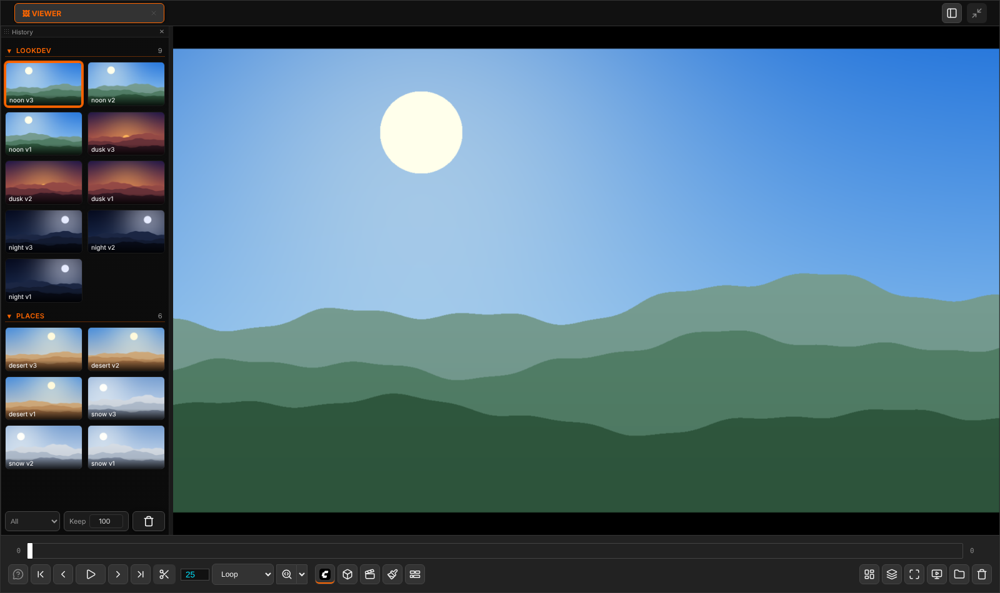
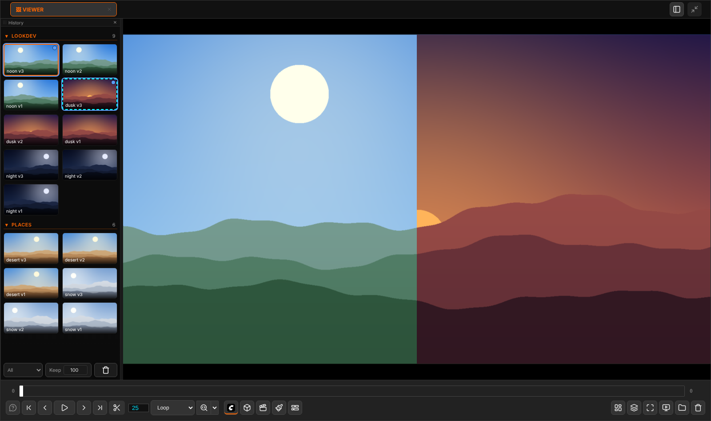
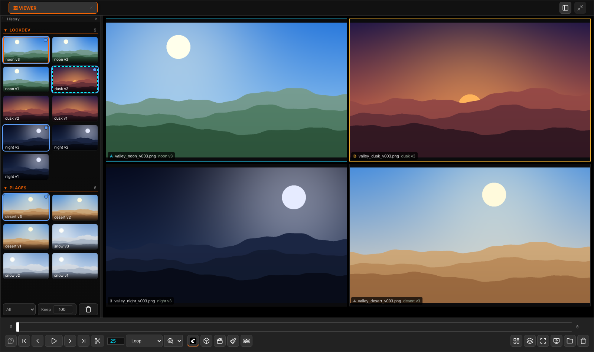
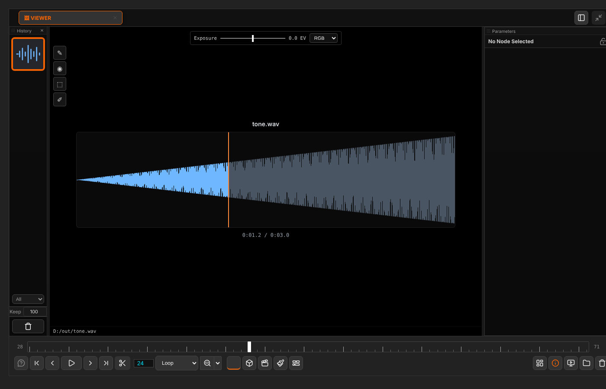

# Viewer

[Home](index.md)

The **🖼 Viewer** tab is where pictures, videos and sounds are looked at. Everything you only look at goes here; documents (a cut, a Paint canvas, a 3D or Motion scene) get spaces of their own.

## Getting things in

- A **Send To Image Viewer** node: its renders become a group of the Viewer, named by its `group` input. See [Nodes](nodes.md).
- Right-click any node ▸ **Send to Image Viewer**. A loader opens its file; any other node runs its branch first. With several nodes selected it sends them all.
- Open or drag files from the [file browser](workspace.md#file-browser), or drop them from the desktop.

A new render is put on screen only while you are looking at the newest one. Looking at something older, it waits in the [History](history.md).

## Looking

| To | Do |
|---|---|
| Zoom | The zoom menu, or <kbd>F</kbd> to fit |
| Pan | Drag the picture |
| Hide everything drawn over the picture | <kbd>S</kbd>, or **Toggle Overlays** in the lower bar |
| Show a framing mask (4:3, 16:9, 1.85, 21:9, 2.39, 9:16, 1:1, 4:5 or your own ratio) | **Framing mask** right of Toggle Overlays, or <kbd>Shift</kbd>+<kbd>G</kbd>; its ▾ (or a right-click) picks the ratio and the opacity. It is drawn in the Edit space too, and in 3D inside the camera gate |
| Full screen | <kbd>Shift</kbd>+<kbd>F</kbd>, or the button in the transport. <kbd>Esc</kbd> comes back |
| Exposure | The slider at the top (−4 to +4 EV), or hold <kbd>E</kbd> and drag. Right-click resets |
| One channel | <kbd>R</kbd>, <kbd>G</kbd>, <kbd>B</kbd> (again for RGB) |
| Input colourspace | The menu at the end of the exposure bar (OpenColorIO). Scene-linear files start on linear, renders on sRGB |

Exposure and channels only change what you see, never the file. On a 3D tab they are off.

## Comparing

| To | Do |
|---|---|
| Wipe two tabs or two History items | <kbd>Shift</kbd>+click the first, then the second. Drag the divider |
| Compare three or more | <kbd>Ctrl</kbd>+click them in the History, then <kbd>C</kbd>: a contact sheet of all of them, up to 16 |
| Change mode | <kbd>C</kbd> cycles, or the compare button: vertical split, horizontal split, contact sheet |
| Stop comparing | <kbd>C</kbd>, or click a tab |

Videos in a compare play in step. A second source of another size is stretched over the first, so the wipe always covers the frame.

## Playing

The transport plays image sequences, videos and sounds.

| To | Do |
|---|---|
| Play / pause | <kbd>Space</kbd> |
| Step | <kbd>←</kbd> <kbd>→</kbd> (<kbd>Ctrl</kbd>: first / last frame) |
| Loop part of it | <kbd>Ctrl</kbd>+drag on the timeline |
| Speed and loop mode | The fps box and the Loop / Ping-Pong / Once menu |
| Put a frame on the graph | Hold <kbd>Shift</kbd> and drag the timeline onto the graph: a Load Image node with that frame (a video frame is saved as a PNG first) |

**Sounds** (WAV, MP3, FLAC, OGG, M4A, AAC, Opus) show their waveform. Click it to seek.

## Drawing tools

The small toolbar at the top left of the picture holds **Roto**, **SAM3 points**, **SAM3 boxes** and **Annotate**. Their options are in the Parameters panel while a tool is on.

- **Roto** draws mattes onto a *Roto* node, **SAM3** draws prompts onto a *SAM3 Collector* node. Pressing the tool's button adds and wires the node if there is none. See [Nodes](nodes.md#roto-and-sam3-collector).
- **Annotate** draws text, arrows, boxes and strokes. The marks are saved beside the file (`still.png` → `still.annotations.json`). On a video a mark belongs to frames; **◀ Mark / Mark ▶** jump between them. With agentY, **Send to agentY** sends the marks as a message.
