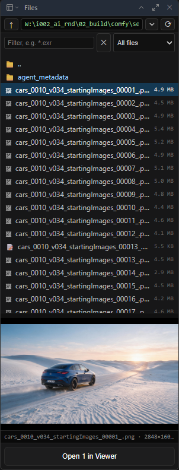

# Panels & workspace

[Home](index.md)

## The panel itself

- **Image Viewer** in ComfyUI's top bar shows and hides it.
- **Floating**: drag the tab bar's empty area to move it, its edges to resize it.
- **Docked**: the **Dock** button (or <kbd>Shift</kbd>+<kbd>D</kbd>) makes it a panel beside the canvas, left, right or bottom.
- **Undocked**: the **Undock** button opens it in its own browser window, for a second screen. Every key works there. Allow pop-ups if nothing happens. A browser won't let that window be dragged into another one; with *Settings > ComfyUI Image Viewer > Docking > Undock opens the viewer in* set to **A browser tab** it opens as a tab instead, which can be dragged into any window of the browser like any other tab.

## Panels

History, the file browser, Parameters, Agent code, Dataset and each space's panels sit in rails: left, right and along the bottom.

- Drag a panel by its title bar onto an edge of the picture, or above / below another panel. Drop it on the middle of another panel to share its place as a tab.
- Drag the bars between them to resize. **✕** puts a panel away; the lower bar's menus bring it back.
- The **layout** menu stores the whole arrangement under a name, and can make one the default.

The lower bar holds playback on the left, then the menus: **ComfyUI** (History, Parameters, Agent code, Dataset, agentY), **3D**, **Motion**, **Paint** and **Timeline**.

## File browser

The folder button in the lower bar. It lists everything in a folder, with previews.

- **Filter** takes wildcards (`*.exr`, `hero_??.png`) and keeps them as you move between folders. **Kind** narrows to images, video, audio, 3D and so on.
- Double-click to open, or drag rows onto the picture, onto the graph (a loader node), into a cut or into the agentY chat.
- A folder of images opens as one sequence.

### Which folders it can open

ComfyUI's input, output and temp folders, plus the ones you add in **Settings ▸ ComfyUI Image Viewer ▸ Folders**. No restart needed. See [Reference](reference.md#folders) for the file and environment variable.

## Parameters

Shows the widgets of the node selected on the graph, and lets you change them. With several nodes selected, all of them are listed. The padlock keeps it on one node. With nothing selected it shows the node behind the picture on screen.

While a drawing tool is on, Parameters holds that tool's options.

## Settings

**Settings ▸ ComfyUI Image Viewer** has the allowed folders and the defaults for playback, compare, History, the file browser, annotation, 3D and docking. They are kept per user, so they follow you across ComfyUI installs. Keys are in **Settings ▸ Keybinding** (see [Hotkeys](hotkeys.md)).

**Colours** changes the viewer's look while it is open: the panels' backgrounds, their title bars, the tab bar and the lower bar, buttons, text, borders, the accent and the background behind the picture, and the Edit page's own colours (timeline, track lanes, ruler, track headers, Inspector section headers, video clips, clips on higher tracks, sound clips, selection, playhead). *Use the colours* decides whether the viewer's colours are used only while a cut's tab is up (the default) or everywhere; the Edit page's own colours are always used. A clip you coloured yourself keeps its colour. *Reset colours* puts them all back.
